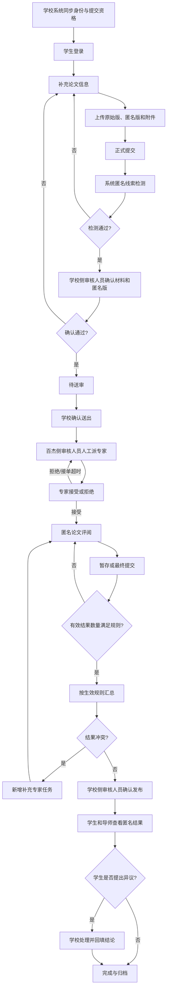
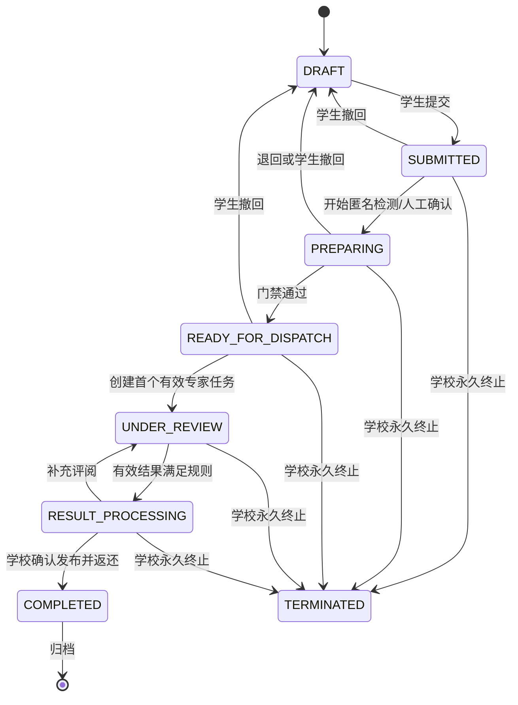
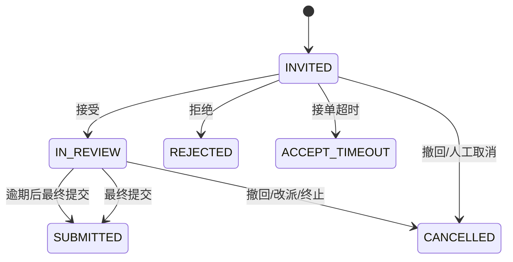

# 百杰校审平台产品与流程设计

## 1. 流程目录

| 编号 | 流程 | 主要角色 |
|---|---|---|
| FLOW-001 | 学校数据同步与学生提交 | 学校系统、学生 |
| FLOW-002 | 送审准备与匿名化门禁 | 学生、学校侧审核人员 |
| FLOW-003 | 学校确认送出与百杰派单 | 学校侧/百杰侧审核人员 |
| FLOW-004 | 专家接单与评阅 | 专家 |
| FLOW-005 | 超时、催审和改派 | 百杰侧审核人员、专家 |
| FLOW-006 | 结果汇总、冲突与补充评阅 | 系统、百杰侧/学校侧审核人员 |
| FLOW-007 | 结果发布与查看 | 学校侧审核人员、学生、导师 |
| FLOW-008 | 撤回与永久终止 | 学生、学校侧审核人员 |
| FLOW-009 | 异议登记与学校处理 | 学生、学校侧审核人员 |
| FLOW-010 | 费用与提现申请 | 专家、百杰侧审核人员 |

## 1.1 流程结构化说明

每条流程给出前置条件、主流程、异常流程和结果，作为设计、验收与测试的基线。前置条件未满足时流程不可开始；异常流程由主流程中的某一步触发，返回对应前置状态或进入待处理集合。

### FLOW-001 学校数据同步与学生提交

- **参与角色**：学校系统（权威主数据）、学生、系统管理员（配置同步）。
- **前置条件**：租户已启用；学校同步字段映射已配置；学生已有平台账号或可由 SSO 自动绑定。
- **主流程**：
  1. 学校系统按字段映射推送学生、导师、组织、批次和提交资格；
  2. 系统幂等处理并记录源版本，迟到旧版本不覆盖新数据；
  3. 学生通过学校身份渠道登录并确认本人资格；
  4. 学生创建论文草稿并补充题目、摘要、送审专业方向等信息。
- **异常流程**：
  - 同步签名/来源校验失败 → 记录失败并告警，不落库；
  - 字段映射缺失或类型不符 → 记录失败原因，等待配置修正后重试；
  - 学生无资格或批次已过期 → 禁止创建/提交并提示。
- **结果**：学生具备有效提交资格并可维护本人论文草稿。

### FLOW-002 送审准备与匿名化门禁

- **参与角色**：学生、学校侧审核人员。
- **前置条件**：论文处于 `DRAFT` 且学生有资格；已补充论文信息。
- **主流程**：
  1. 学生上传原始版、匿名版和必需附件；
  2. 学生正式提交；
  3. 系统抽取正文/文件名/元数据执行匿名线索检测；
  4. 学校侧审核人员对匿名版作材料与身份线索确认。
- **异常流程**：
  - 检测命中姓名/学号/导师/致谢等 → 返回结构化检查项，论文退回 `DRAFT`；
  - 审核人员确认不通过 → 退回 `DRAFT` 并说明原因；
  - 文件校验失败（类型/大小/可读性/加密） → 阻断提交并提示重传。
- **结果**：论文进入 `READY_FOR_DISPATCH`，匿名版被确认为可送审版本。

### FLOW-003 学校确认送出与百杰派单

- **参与角色**：学校侧审核人员、百杰侧审核人员。
- **前置条件**：论文处于 `READY_FOR_DISPATCH`；匿名门禁已通过。
- **主流程**：
  1. 学校侧审核人员确认送出；
  2. 百杰侧审核人员按送审专业方向、专家擅长领域与学科检索候选专家；
  3. 系统执行回避检查；
  4. 百杰侧审核人员人工指派专家并创建专家任务；
  5. 系统发送接单通知。
- **异常流程**：
  - 无符合条件候选专家 → 提示并等待补充专家或调整方向；
  - 命中回避关系 → 提示原因，禁止指派，需选择其他专家；
  - 并发指派同一论文/席位 → 冲突请求返回明确错误，不产生重复任务。
- **结果**：创建送审轮次及首组 `INVITED` 专家任务，论文进入 `UNDER_REVIEW`。

### FLOW-004 专家接单与评阅

- **参与角色**：专家。
- **前置条件**：专家存在 `INVITED` 任务且未超时。
- **主流程**：
  1. 专家查看匿名基本信息和期限；
  2. 专家显式接受，任务进入 `IN_REVIEW`；
  3. 专家访问完整匿名材料并填写评阅（可暂存草稿）；
  4. 专家最终提交，任务进入 `SUBMITTED` 并锁定。
- **异常流程**：
  - 专家拒绝 → 记录原因，任务进入 `REJECTED`，通知改派；
  - 接单超时 → 任务自动进入 `ACCEPT_TIMEOUT`，通知改派；
  - 评阅逾期 → 任务标记逾期并催审，不自动删除草稿；
  - 最终提交校验失败（缺必填项/分数越界） → 返回字段级错误。
- **结果**：产生一份锁定且可审计的专家原始结果。

### FLOW-005 超时、催审和改派

- **参与角色**：百杰侧审核人员、专家。
- **前置条件**：存在 `INVITED`/`IN_REVIEW` 且带逾期的任务。
- **主流程**：
  1. 系统按期限扫描并发送催审/临期提醒；
  2. 审核人员评估延期、催审或改派；
  3. 改派时在原轮次创建新专家任务，原任务进入 `CANCELLED` 并保留历史。
- **异常流程**：
  - 专家在催审后仍超时 → 审核人员选择改派或终止任务；
  - 改派并发冲突 → 版本冲突反馈，不覆盖已有任务。
- **结果**：任务要么恢复有效评阅，要么以明确终态关闭并完成改派。

### FLOW-006 结果汇总、冲突与补充评阅

- **参与角色**：系统、百杰侧审核人员、学校侧审核人员。
- **前置条件**：有效专家结果数量满足轮次规则；规则快照可用。
- **主流程**：
  1. 系统按规则快照汇总有效结果（分项平均或总分模式）；
  2. 命中冲突条件时标记冲突，不自动裁定；
  3. 百杰侧审核人员新增补充专家任务；
  4. 补充结果纳入有效集合后重新汇总，生成新汇总版本。
- **异常流程**：
  - 无汇总规则 → 仅展示各专家独立结果，不生成结论；
  - 汇总版本冲突 → 返回版本错误，不静默覆盖。
- **结果**：论文进入 `RESULT_PROCESSING`，形成可发布或待补审的汇总版本。

### FLOW-007 结果发布与查看

- **参与角色**：学校侧审核人员、学生、导师。
- **前置条件**：论文处于 `RESULT_PROCESSING`；汇总/冲突已处理。
- **主流程**：
  1. 学校侧审核人员确认发布；
  2. 发布后学生查看本人各专家分数、获准评语与汇总；
  3. 导师查看本人学生的匿名结果。
- **异常流程**：
  - 未发布前学生/导师访问 → 返回不可见，不泄露专家身份；
  - 发布后补充评阅导致汇总变化 → 创建新发布记录，不修改历史发布。
- **结果**：论文进入 `COMPLETED`，结果可审计地返还学生与导师。

### FLOW-008 撤回与永久终止

- **参与角色**：学生、学校侧审核人员。
- **前置条件**：论文在 `SUBMITTED`/`PREPARING`/`READY_FOR_DISPATCH`/`UNDER_REVIEW`。
- **主流程**：
  1. 派单前：学生撤回，论文返回 `DRAFT`，保留版本与记录；
  2. 派单后：学生提交撤回申请，学校侧审核人员审批；
  3. 永久终止：学校侧审核人员填写原因后终止，论文进入 `TERMINATED`。
- **异常流程**：
  - 撤回申请被拒 → 原轮次与任务继续有效；
  - 无权终止（系统管理员/专家） → 拒绝并审计；
  - 终止后再次操作 → 只读，提示不可恢复。
- **结果**：论文回到 `DRAFT` 可重新提交，或进入不可逆的 `TERMINATED`。

### FLOW-009 异议登记与学校处理

- **参与角色**：学生、学校侧审核人员。
- **前置条件**：论文已发布（`COMPLETED`）。
- **主流程**：
  1. 学生提交异议理由和附件；
  2. 系统通知学校侧审核人员并跟踪状态（提交→处理中→已办结）；
  3. 学校线上处理或在处理完成后回填方式和结论。
- **异常流程**：
  - 附件越权或超期 → 拒绝提交并提示；
  - 学校决定正式复核 → 按已确认规则创建新评审轮次（独立流程）。
- **结果**：异议办结并留痕；不改变论文宏观状态。

### FLOW-010 费用与提现申请

- **参与角色**：专家、百杰侧审核人员。
- **前置条件**：存在有效评阅结果；费用规则快照可用。
- **主流程**：
  1. 系统按规则生成费用与余额流水（幂等，不重复入账）；
  2. 专家在线提交提现申请；
  3. 百杰侧审核人员人工审核并线下付款；
  4. 付款结果回填，流水冲正保留历史。
- **异常流程**：
  - 重复提交/并发提现 → 幂等键与唯一约束阻止重复入账；
  - 审核驳回 → 记录原因，余额冻结解除；
  - 余额不足 → 拒绝提现申请。
- **结果**：费用入账、提现完成或驳回，均保留完整可审计流水。

## 2. 端到端主流程

## 3. 论文阶段状态机

### 3.1 状态定义

论文状态只表达宏观业务阶段，不承载单个专家任务的细节；送审轮次与专家任务各自的进度由对应子状态表达。`OVERDUE` 不作为独立状态，而是专家任务状态的逾期标记。

| 状态 | 中文 | 进入条件 | 允许动作 | 退出条件 |
|---|---|---|---|---|
| `DRAFT` | 草稿 | 学生首次创建、退回或撤回 | 编辑、上传、删除未引用草稿文件、提交 | 学生提交进入 `SUBMITTED`；可被永久终止 |
| `SUBMITTED` | 已提交 | 学生通过提交校验 | 进入送审准备、派单前撤回 | 开始送审准备进入 `PREPARING`；撤回回 `DRAFT`；终止 |
| `PREPARING` | 送审准备中 | 匿名检测或人工确认开始 | 确认通过、退回、派单前撤回 | 门禁通过进入 `READY_FOR_DISPATCH`；退回/撤回回 `DRAFT` |
| `READY_FOR_DISPATCH` | 待送审 | 材料与匿名门禁通过 | 学校确认送出、派单前撤回 | 创建首个有效专家任务进入 `UNDER_REVIEW`；撤回回 `DRAFT` |
| `UNDER_REVIEW` | 送审中 | 首个有效专家任务已创建 | 催审、改派、补充任务、撤回申请 | 有效结果满足规则进入 `RESULT_PROCESSING`；撤回获批回 `DRAFT` |
| `RESULT_PROCESSING` | 结果处理中 | 有效结果满足数量条件 | 汇总重算、补充评阅、确认发布 | 补充评阅回 `UNDER_REVIEW`；发布进入 `COMPLETED` |
| `COMPLETED` | 已完成 | 结果已由学校确认发布并返还 | 查看、导出、登记/处理异议、归档 | 归档（标记属性）后仅只读受控访问 |
| `TERMINATED` | 已终止 | 学校侧审核人员永久终止 | 只读 | 无（不可逆） |

进入 `COMPLETED` 即表示评阅完成、结果已返还学生；后续异议、费用结算与归档为独立业务域，不再改变论文宏观状态。

### 3.2 状态图

所有转换必须由流程模块校验预期版本和操作者权限，禁止其他模块直接修改论文阶段。

## 4. 送审轮次与专家任务

### 4.1 送审轮次状态

| 状态 | 说明 |
|---|---|
| `CREATED` | 轮次已建立，尚无有效邀请 |
| `ACTIVE` | 存在待接单、评阅中或逾期任务 |
| `RESULT_READY` | 有效提交数量满足规则 |
| `COMPLETED` | 本轮结果已发布/纳入最终结果 |
| `CANCELLED` | 撤回或永久终止导致本轮关闭 |

### 4.2 专家任务状态

任务状态只保留真正影响处理的节点；"已接受但逾期"不设独立状态，以 `IN_REVIEW`/`SUBMITTED` 上的逾期标记表示（用于催审、延期和统计，不改变任务主状态）。

| 状态 | 是否终态 | 说明 |
|---|---:|---|
| `INVITED` | 否 | 已邀请，等待显式接受/拒绝 |
| `IN_REVIEW` | 否 | 已接受，评阅期限内；可带逾期标记 |
| `SUBMITTED` | 是 | 最终提交并锁定 |
| `REJECTED` | 是 | 专家拒绝并记录原因 |
| `ACCEPT_TIMEOUT` | 是 | 接单期限无响应，自动关闭 |
| `CANCELLED` | 是 | 撤回、终止或人工改派关闭，记录原因 |

延期、逾期标记和催审作为 `IN_REVIEW` 上的时限属性与审计事件管理，不增加独立状态；改派创建新专家任务，旧任务进入 `CANCELLED`。普通改派仍创建新专家任务；论文版本变化或正式复核才创建新轮次。

## 5. 关键异常流程

### 5.1 派单前撤回

学生在 `SUBMITTED`、`PREPARING` 或 `READY_FOR_DISPATCH` 撤回，论文返回 `DRAFT`。系统保留版本、提交、检测、审核和撤回记录。

### 5.2 派单后撤回

学生提交申请；学校侧审核人员批准后，当前轮次进入 `CANCELLED`，未完成专家任务进入 `CANCELLED`，已提交结果保留但标记不参与汇总，论文返回 `DRAFT` 并形成新论文版本。撤回申请被拒绝时，原轮次和任务继续有效。

### 5.3 永久终止

只有学校侧审核人员可因学校撤销资格、严重材料问题或正式决定终止；必须填写原因。系统管理员不得执行。终止后原流程不可恢复。

### 5.4 结果更正

专家最终提交后不能自行编辑。专家提交更正申请，百杰侧审核人员批准后创建新结果版本，旧版本继续可审计。

### 5.5 结果冲突

系统依据规则标记冲突但不裁定。百杰侧审核人员新增补充专家任务；所有有效结果按同一规则重新计算。任何审核人员不得编辑专家原始分数。

### 5.6 异议处理

学生可在结果发布后提交异议理由和附件；系统通知学校侧审核人员并跟踪 `已提交 → 处理中 → 已办结`。异议作为独立流程，不回退或覆盖论文宏观状态；若学校决定正式复核，则按已确认规则创建新评审轮次。学校可在线处理，也可在线下处理后回填方式和结论。异议提交期限由学校制度或批次规则决定，当前尚未确认时不得由系统擅自设置默认期限。完整在线复核属于 P1，不在 P0 创建空实现。

## 6. 页面清单

| 编号 | 页面 | 主要角色 | 核心能力 |
|---|---|---|---|
| PAGE-001 | 登录/学校入口 | 全部 | 学校身份登录、专家账号登录 |
| PAGE-002 | 学生论文工作台 | 学生 | 草稿、提交资格、进度、结果、异议 |
| PAGE-003 | 论文编辑与上传 | 学生 | 信息、送审专业方向、原始版、匿名版、附件、提交 |
| PAGE-004 | 学校送审准备列表 | 学校侧审核人员 | 材料和匿名版确认、退回 |
| PAGE-005 | 学校送审与进度 | 学校侧审核人员 | 确认送出、撤回申请、进度、结果 |
| PAGE-006 | 平台专家库 | 百杰侧审核人员 | 专家档案、擅长领域、资格状态、可用性 |
| PAGE-007 | 平台派单工作台 | 百杰侧审核人员 | 匿名论文、候选专家、派单、改派 |
| PAGE-008 | 专家任务列表 | 专家 | 待接单、评阅中、逾期、已提交 |
| PAGE-009 | 专家接单详情 | 专家 | 匿名基本信息、期限、费用、接受/拒绝 |
| PAGE-010 | 在线评阅工作台 | 专家 | PDF 阅读、动态表单、暂存、最终提交 |
| PAGE-011 | 结果处理工作台 | 学校侧审核人员 | 汇总、冲突与补审进度、确认发布 |
| PAGE-012 | 学生结果与异议 | 学生 | 匿名结果、异议提交和状态 |
| PAGE-013 | 导师结果查看 | 导师 | 本人学生匿名结果 |
| PAGE-014 | 提现与结算 | 专家 | 本人余额、流水、提现申请与处理状态 |
| PAGE-015 | 通知中心 | 授权用户 | 站内通知、发送状态 |
| PAGE-016 | 导出中心 | 审核人员 | 异步任务、下载、过期 |
| PAGE-017 | 租户、组织、批次与权限 | 系统管理员 | 学校、组织/批次同步投影、用户、角色、数据范围 |
| PAGE-018 | 审计查询 | 授权审核人员/系统管理员 | 按职责查看系统或业务审计 |
| PAGE-019 | 学校异议处理工作台 | 学校侧审核人员 | 异议受理、处理记录、结论回填、复核决定留痕 |
| PAGE-020 | 评阅更正审批 | 百杰侧审核人员 | 更正申请审核、版本差异、批准生成新版本 |
| PAGE-021 | 专家资料与资格 | 专家 | 本人资料、擅长领域、资格材料和审核状态 |
| PAGE-022 | 结算处理工作台 | 百杰侧审核人员（财务职能权限） | 提现审核、线下付款结果回填、冲正留痕 |
| PAGE-023 | 批次与评审规则 | 学校侧审核人员（批次配置权限） | 专家人数、期限、评阅模板、汇总与冲突规则版本 |

## 7. 唯一状态与枚举表

以下枚举是数据库、API、前端和测试的唯一依据。`OVERDUE` 已从专家任务状态中移除，改为评阅逾期的标记属性；论文状态中不存在 `ARCHIVED`（归档为审计与导出属性，不改变业务阶段）；评分汇总不依赖固定等级。

| 枚举 | 取值 | 说明 |
|---|---|---|
| 论文状态 | `DRAFT`、`SUBMITTED`、`PREPARING`、`READY_FOR_DISPATCH`、`UNDER_REVIEW`、`RESULT_PROCESSING`、`COMPLETED`、`TERMINATED` | 宏观业务阶段 |
| 送审轮次状态 | `CREATED`、`ACTIVE`、`RESULT_READY`、`COMPLETED`、`CANCELLED` | 轮次生命周期 |
| 专家任务状态 | `INVITED`、`IN_REVIEW`、`SUBMITTED`、`REJECTED`、`ACCEPT_TIMEOUT`、`CANCELLED` | 任务生命周期 |
| 任务逾期标记 | `overdue` | `IN_REVIEW`/`SUBMITTED` 上的时限属性，不改变主状态 |
| 文件用途 | `original`（原始版）、`anonymous`（匿名版）、`attachment`（附件）、`qualification`（资质）、`objection`（异议附件）、`export`（导出文件） | 文件对象与访问策略依据 |
| 匿名检查结论 | `PASS`、`FAIL`、`REVIEW_REQUIRED` | 自动检测与人工确认结论 |
| 汇总模式 | `average_score`（分项平均）、`total_score`（总分+评语）、`none`（无规则，仅展示独立结果） | 由学校/批次版本化配置 |
| 结果冲突标记 | `CONFLICT`、`NONE` | 仅标记，不自动裁定 |
| 异议状态 | `SUBMITTED`、`PROCESSING`、`RESOLVED` | 独立于论文宏观状态 |
| 提现申请状态 | `SUBMITTED`、`REVIEWING`、`PAID`、`REJECTED`、`REVERSED` | P0 人工审核与线下付款回填 |
| 租户状态 | `ACTIVE`、`SUSPENDED`、`CLOSED` | `SUSPENDED` 禁止新业务，历史保留；`CLOSED` 终态只读 |
| 批次状态 | `DRAFT`、`OPEN`、`SUBMISSION_CLOSED`、`ARCHIVED` | 批次生命周期；`DRAFT` 配置中，`OPEN` 可提交，`SUBMISSION_CLOSED` 停止提交 |
| 组织类型 | `COLLEGE`、`MAJOR`、`DEPT`、`OTHER` | 学校组织树节点类型 |
| 同步状态 | `PENDING`、`RUNNING`、`SUCCESS`、`PARTIAL`、`FAILED` | 外部同步作业状态；`PARTIAL` 记录成功/失败逐项 |
| 资格状态 | `ELIGIBLE`、`SUSPENDED`、`EXPIRED`、`REVOKED` | 学生提交资格；由学校权威主数据决定 |
| 成员关系类型 | `STUDENT`、`SUPERVISOR`、`STAFF`、`OTHER` | 用户与租户/组织的关系 |
| 用户状态 | `ACTIVE`、`DISABLED`、`LOCKED` | 平台账号状态 |
| 同步方向 | `INBOUND`、`OUTBOUND` | 当前仅 `INBOUND`（学校→平台） |
| 同步记录状态 | `PENDING`、`SUCCESS`、`FAILED`、`SKIPPED` | `external_sync_records` 逐条记录状态 |

## 8. 交互统一规则

1. 状态按钮必须由服务端返回的允许动作驱动，不能仅由前端推断。
2. 派单、最终提交、发布、撤回批准和付款回填必须二次确认并防重复提交。
3. 列表必须展示空、加载、失败、部分成功和无权限状态。
4. 文件上传需展示进度、失败原因、重试和校验结果。
5. 专家身份不得出现在学校侧页面、URL、文件名、日志或导出中。
6. 学生身份不得出现在专家页面中；百杰侧派单与运营页面可展示学生/导师与专家身份，用于派单、进度和费用管理，但不得外泄给学校侧或专家侧。
7. 所有截止时间展示租户时区和绝对时间，不只显示”剩余几天”。
8. 异步任务返回任务编号，用户可关闭页面后继续查询。
