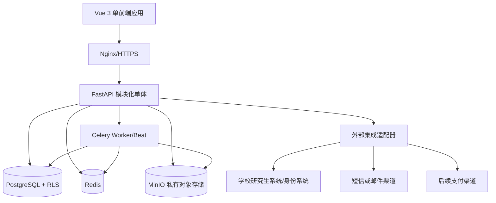
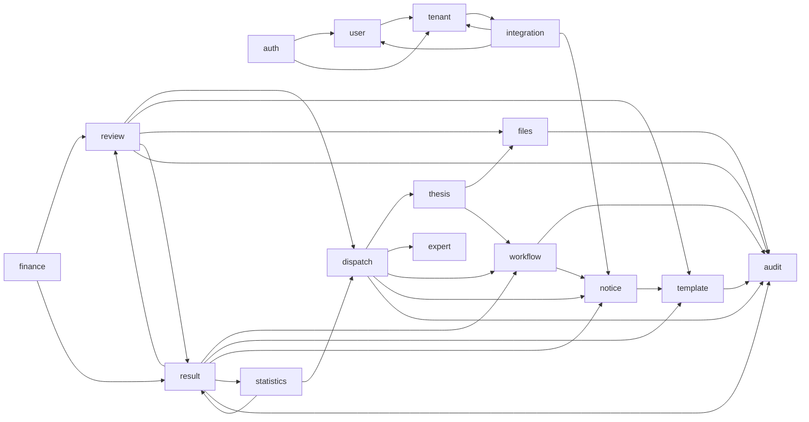

# 百杰校审平台总体架构与安全设计

## 1. 架构结论

MVP 使用前后端分离的模块化单体：

- 前端：Vue 3 + TypeScript + Vite + Element Plus；
- 后端：FastAPI + SQLAlchemy 2 + Alembic；
- 数据库：PostgreSQL；
- 缓存/异步：Redis + Celery；
- 文件：MinIO/S3 兼容私有对象存储；
- 接入：Nginx + HTTPS；
- 部署：Docker Compose。

不在 MVP 拆微服务。只有存在第二个真实适配器或独立扩缩需求时才建立新的外部进程或服务。

## 2. 逻辑架构

## 3. 模块及深度

每个模块对外提供一个小接口，隐藏状态校验、权限、事务、审计和事件。调用方不得绕过接口直接写其他模块表。

| 模块 | 状态/数据所有权 | 对外接口职责 |
|---|---|---|
| auth | 登录会话、凭证、身份绑定 | 认证、刷新、注销、当前身份 |
| tenant | 租户、组织、批次、学校规则 | 租户上下文、组织范围、规则快照 |
| user | 用户、角色、权限、数据范围 | 授权判断与角色绑定 |
| thesis | 论文、版本、附件、提交资格引用、送审专业方向 | 草稿、提交、文件绑定、版本查询 |
| workflow | 论文阶段、审核任务、撤回/终止记录 | 唯一阶段转换接口与允许动作 |
| expert | 平台专家、资格、领域、可用性 | 专家维护和候选查询 |
| dispatch | 送审轮次、专家任务、邀请、改派 | 派单、接单、超时、取消、补充任务 |
| review | 评阅草稿、结果版本、表单答案 | 暂存、最终提交、更正申请 |
| result | 汇总、冲突、发布、异议 | 规则计算、发布、异议状态 |
| finance | 费用、余额、提现、付款记录 | 计费、申请、审核、付款回填 |
| notice | 消息、模板、发送记录 | 发送、重试、去重、站内消息 |
| files | 文件对象、访问授权、访问日志 | 上传、受控预览/下载、过期 |
| template | 评阅/通知/导出模板版本 | 发布模板、按快照渲染 |
| audit | 只追加审计事件 | 查询与导出授权范围内审计 |
| statistics | 只读聚合 | 基础进度和运营指标 |
| integration | 外部同步与回执 | 统一学校、通知、支付适配器 |

### 3.1 关键接口原则

- `workflow.transition(...)` 是论文阶段变化的唯一接口；
- `dispatch.assign/reassign/supplement(...)` 隐藏任务替换和历史保留；
- `review.submit_final(...)` 在一个事务中完成校验、锁定、版本和事件；
- `result.calculate(...)` 只接受规则快照和有效结果，不读取当前可变规则；
- `files.authorize(...)` 在返回文件流或临时链接前执行租户、角色和对象关系校验；
- 通知、对象存储、学校系统和未来支付位于适配器接缝，可使用测试适配器。

### 3.2 模块调用关系

模块之间只通过应用服务接口协作，不直接访问其他模块私有表；跨模块状态修改必须经过对应领域服务。

| 调用方 | 被调用模块 | 用途 |
|---|---|---|
| auth | user、tenant | 身份绑定、角色与租户上下文 |
| user | tenant | 组织/批次数据范围 |
| tenant | integration | 读取学校规则/字段映射配置来源 |
| thesis | files、workflow | 文件绑定与授权、提交状态流转 |
| workflow | audit、notice | 状态事件审计与通知 |
| dispatch | thesis、expert、workflow、notice、audit | 读匿名论文与送审方向、候选专家与回避、任务状态流转、接单通知、指派审计 |
| review | dispatch、template、files、result、audit | 读取本人任务与模板、访问匿名材料、写结果版本 |
| result | workflow、review、template、notice、statistics、audit | 读取有效结果与规则快照、汇总发布、发布通知、统计与审计 |
| finance | review、result | 由有效评阅结果生成费用 |
| notice | template | 通知模板渲染 |
| files | audit | 文件访问审计 |
| template | audit | 模板版本发布审计 |
| statistics | result、dispatch | 只读聚合 |
| integration | tenant、user、notice | 学校同步、身份、通知渠道适配 |
| audit | — | 只追加事件，不依赖其他业务模块 |

说明：

- 状态变化入口集中在 `workflow`（论文阶段）与 `dispatch`/`review`/`result`（轮次、任务、结果版本），调用方不得直接更新状态字段；
- `files.authorize` 在返回文件流/短时链接前做租户、角色和对象关系校验，是文件访问的唯一受控入口；
- `statistics` 只读聚合，不反向修改业务模块；
- 外部系统（学校同步、通知渠道、未来支付）一律通过 `integration` 适配器进入，模块不直连外部。

## 4. 多租户设计

### 4.1 数据层

- 学校业务表必须含非空 `tenant_id`；
- PostgreSQL 行级安全按请求租户上下文限制学校数据；
- 应用查询仍显式带租户条件，RLS 是第二道防线；
- 平台专家等平台级表不得伪造学校租户；
- 跨租户运营统计只允许读取脱敏聚合数据且需独立权限；P0 不提供该能力。

### 4.2 文件层

- 对象键包含不可猜测 ID，不包含学生、导师或专家姓名；
- 学校文件按独立 bucket 或强制租户前缀隔离；
- 原始版、匿名版、评阅书和临时导出使用不同用途前缀和策略；
- 任何对象访问必须先通过数据库授权，禁止公开桶和永久 URL。

### 4.3 缓存和任务

- 缓存键和分布式锁必须含租户或平台作用域；
- 异步任务载荷携带 tenant_id、actor_id、trace_id 和规则版本；
- Worker 处理前重新建立租户上下文，不能信任调用方传入的资源归属。

## 5. 送审专业方向与评分模式

### 5.1 送审专业方向

- 平台维护专业/学科目录；学生提交时选择本篇论文的送审专业方向；
- 专家维护个人资料并填写擅长评审领域；
- 派单时按送审专业方向与专家擅长领域匹配候选，并排除回避关系；学生按专业方向选择不等于指定具体专家；
- 专业目录与专家擅长领域使用受控标签/编码，自由文本不得绕过回避检查。

### 5.2 评分模式

- 评阅模板按学校/批次版本化配置，支持两种模式：
  - 分项打分：多个评分项分别打分，系统计算平均分并保留分项明细；
  - 总分+评语：直接给出总分和评语。
- 汇总规则只接受规则快照和有效结果计算，不读取当前可变规则；
- 无论哪种模式，每位专家的分项、总分和评语都作为原始结果独立保存，汇总不覆盖原始结果；
- 返还结果时展示分数与获准发布的评语，不包含专家身份。

## 6. 双向盲审安全模型

### 6.1 信息分区

| 区域 | 可见信息 | 不可见信息 |
|---|---|---|
| 学校侧 | 学生/导师、原始版、匿名版、匿名结果 | 专家身份、联系方式、平台使用历史 |
| 百杰运营侧 | 学生/导师、专家身份、匿名论文、学科/专业方向、任务规则、进度与费用 | 原始版（默认）、跨校业务数据共享 |
| 专家侧 | 本人任务、匿名论文、评阅表 | 学生/导师、其他专家和评语 |
| 学生/导师侧 | 发布后的匿名分数、评语、汇总 | 专家身份、未发布结果 |
| 系统管理侧 | 租户、账号、系统配置、技术日志 | 论文正文、评阅内容、双方身份映射（默认） |

平台运营侧可见学生/导师与专家身份，仅用于派单、进度、结果和费用结算运营并全程审计；这不构成学校之间的数据共享，也不改变专家与作者/导师之间的双向盲审隔离。学校侧审核人员始终不得识别专家。

### 6.2 匿名化门禁

1. 学生上传原始版与匿名版；
2. 系统检测正文抽取文本、文件名、元数据和配置词项；
3. 学校侧审核人员只对匿名版作材料/身份线索确认，不作学术审批；
4. 未通过时返回草稿，不允许派单；
5. 专家文件授权只指向已确认匿名版的不可变版本。

### 6.3 破盲

P0 不提供日常破盲按钮。确有安全、法律或学校正式事件时，必须依据外部批准凭证，由具备专门授权的人员执行受控查询，记录凭证、原因、对象、时间和结果。系统管理员角色本身不自动具备该权限。

## 7. 认证与授权

- 学生和导师通过学校身份适配器登录并绑定平台用户，两者共用同一学校身份渠道；
- 专家使用平台账号（自建账号）和验证渠道登录；
- 系统管理员和审核人员使用平台账号，重要操作需要再次确认；
- 采用短期访问令牌和可撤销刷新会话；
- 角色权限、数据范围、资源关系和当前状态共同决定授权；
- 返回 404/403 的策略不得向无权用户泄露资源是否存在。

## 8. 一致性与并发

- 派单、最终提交、汇总、发布、计费使用数据库事务；
- 对论文、轮次、任务、结果摘要使用版本号进行乐观并发控制；
- 外部通知和异步动作采用事务外盒或等价可靠事件机制；
- 幂等键覆盖学校同步、派单、最终提交、发布、费用生成和付款回填；
- 批量操作逐项记录成功/失败，不允许无解释的部分提交。

## 9. 安全控制

- 密码使用现代自适应哈希；密钥不入库、不入日志；
- HTTPS 全程传输；对象存储和备份加密；
- 上传校验扩展名、MIME、大小、可读性、加密状态和恶意内容扫描接口；
- 临时下载链接短时有效且单对象授权；
- 导出文件 7 天失效；
- 审计记录只追加，业务用户不可修改；
- 敏感字段按用途最小化收集和脱敏展示；
- 自动代付不进入 MVP，支付适配器在渠道和合规确认前无生产实现。

## 10. 集成设计

### 10.1 学校主数据接口

统一模型至少包含：学校外部用户标识、学号、姓名、学院、专业、学位类型、导师标识、批次、提交资格、更新时间和源版本。不同学校的字段映射可通过租户级 JSON 配置调整，映射版本化并记录生效时间。同步必须幂等，迟到旧版本不得覆盖新数据；删除采用资格失效/停用语义，不物理删除历史业务引用。

### 10.2 身份登录接口

每个租户选择一个已验证的学校身份适配器。适配器把学校返回的稳定标识映射为平台用户，不保存学校原始密码。具体 CAS/OIDC/OAuth2 等协议在租户接入方案中确定。

### 10.3 通知接口

通知模块只暴露发送意图；渠道适配器负责供应商协议。P0 至少配置站内信和一种外部渠道。每条通知具备业务去重键、模板版本、接收者、状态、重试次数和供应商回执。

### 10.4 支付接口

MVP 仅记录提现申请、人工审核、线下付款和结果回填。未来自动代付适配器必须支持幂等请求、签名验证、异步回调、失败原因和对账；在渠道与合规未批准前不创建假适配器实现。

## 11. 演进触发条件

- 只有出现第二个真实存储/通知/身份适配器时才固化相应接缝；
- 自动匹配在专家领域数据质量和回避规则稳定后进入 P1；
- 文件、通知或支付需要独立扩缩/安全边界时才评估拆服务；
- 单体容量指标经验证不足或组织出现独立发布需求时才评估微服务。
