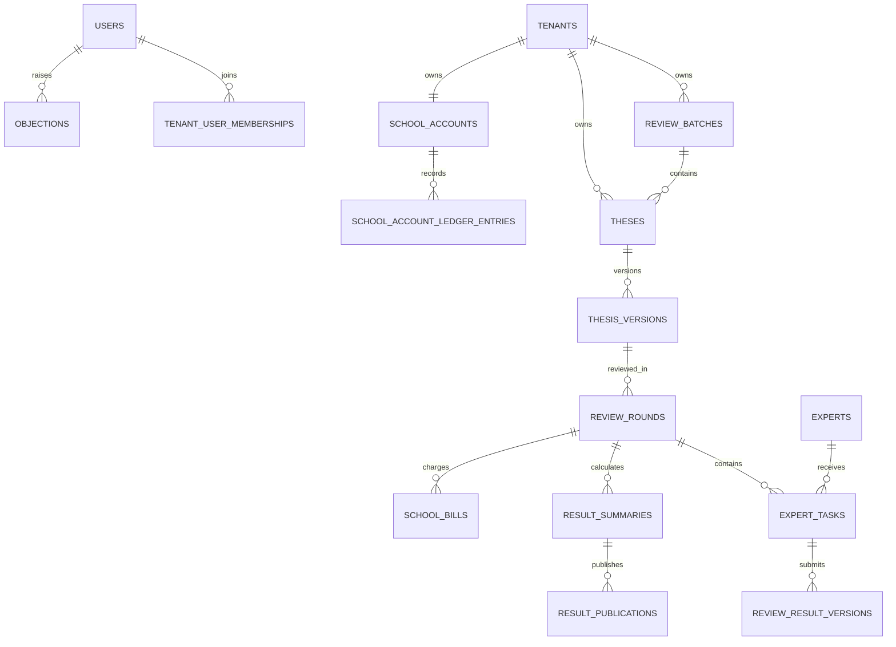

# 数据库设计

## 1. 设计目标与约束

数据库采用 PostgreSQL，共享数据库、共享 Schema 的多租户模型。学校业务数据必须带 `tenant_id`，同时由应用层数据范围过滤和 PostgreSQL RLS 双重隔离。平台共享专家库属于平台域，不归属于单一学校；专家任务、论文、结果和费用等业务关联数据仍必须归属于具体租户。

本设计是逻辑模型和编码前约束，不是数据库迁移脚本。字段长度、索引参数和分区阈值需在实施计划中结合容量估算细化。

## 2. 通用字段规范

| 字段 | 约束 |
|---|---|
| `id` | UUID，服务端生成，不使用可枚举顺序主键 |
| `tenant_id` | 租户业务表必填；平台共享表不得伪造租户归属 |
| `created_at` / `updated_at` | `timestamptz`，统一保存 UTC，展示时转换时区 |
| `created_by` / `updated_by` | 可追溯到操作用户或明确的系统主体 |
| `version` | 需要乐观锁的聚合根使用递增版本号 |
| `deleted_at` | 只用于允许软删除的配置或目录数据；业务历史不得物理删除 |

枚举值以正式状态机为唯一依据；数据库、API 和前端不得各自维护不同名称。金额使用最小货币单位整数或定点数，禁止浮点数。所有外部系统标识必须同时记录来源系统和外部标识。

## 3. 核心表清单

### 3.1 租户、身份与权限

| 编号 | 表 | 核心内容 | 租户规则 |
|---|---|---|---|
| TABLE-001 | `tenants` | 学校租户、状态、配置版本（含同步字段映射 JSON） | 平台级 |
| TABLE-002 | `organizations` | 学校内部组织树及外部组织标识 | `tenant_id` 必填 |
| TABLE-003 | `review_batches` | 学年、批次、起止时间、规则版本 | `tenant_id` 必填 |
| TABLE-004 | `users` | 平台账户、登录状态、基础联系信息 | 平台账户；租户关系另表维护 |
| TABLE-005 | `tenant_user_memberships` | 用户与租户、组织、在校状态、外部身份映射 | `tenant_id` 必填，租户内唯一 |
| TABLE-006 | `roles` | 五类核心角色定义 | 平台预置，不新增业务角色 |
| TABLE-007 | `user_role_assignments` | 用户角色、租户、组织数据范围、有效期 | 学校角色带 `tenant_id`；平台角色显式标记 |
| TABLE-008 | `student_eligibilities` | 培养、批次、提交资格、同步版本 | `tenant_id` 必填，学校系统为权威来源 |
| TABLE-009 | `external_sync_records` | 同步批次、源记录、状态、失败原因 | `tenant_id` 必填 |

`users` 不直接保存可变的学校业务资格。学校侧更正须先在上游系统完成，再同步到 `tenant_user_memberships` 或 `student_eligibilities`。

### 3.2 论文、文件与流程

| 编号 | 表 | 核心内容 | 关键约束 |
|---|---|---|---|
| TABLE-010 | `theses` | 论文聚合根、学生、批次、当前版本、宏观状态 | 学生在批次内的有效论文唯一；`tenant_id` 必填 |
| TABLE-011 | `thesis_versions` | 每次提交版本、题目、学科、摘要、送审专业方向、提交时间 | 已送审版本不可覆盖；重提交新建版本 |
| TABLE-012 | `file_objects` | 对象键、类型、大小、摘要、存储域、扫描状态 | 原件与匿名件使用不同存储域；对象键不可暴露 |
| TABLE-013 | `thesis_version_files` | 论文版本与原件、匿名件、附件关系 | 文件用途枚举统一；同用途版本化 |
| TABLE-014 | `anonymization_checks` | 自动检查项、命中位置、结论、人工确认 | 每次匿名件变更后重新检查 |
| TABLE-015 | `workflow_events` | 状态前后值、动作、原因、操作者、请求标识 | 只追加，不更新、不删除 |
| TABLE-016 | `thesis_withdrawal_requests` | 论文撤回申请、审批、取消范围、理由 | 送审后必须经学校审核人员处理 |
| TABLE-017 | `termination_records` | 终止理由、依据、操作者 | 永久终态记录，不可撤销 |

`theses.current_version_id` 仅是读取优化；历史真相由版本表和事件表共同保存。原始文件与匿名文件必须能独立授权、独立审计、独立撤销访问。

### 3.3 专家、轮次与评阅任务

| 编号 | 表 | 核心内容 | 关键约束 |
|---|---|---|---|
| TABLE-018 | `experts` | 平台共享专家档案、账户、服务状态、擅长评审领域 | 平台级；学校不可直接查询身份 |
| TABLE-019 | `expert_qualifications` | 学科、职称、资质、证明、审核状态 | 版本化并保留审核记录 |
| TABLE-020 | `expert_conflicts` | 显式回避对象、组织、学科或时间范围 | 匹配和人工指派前必须检查 |
| TABLE-021 | `review_rounds` | 论文版本、轮次号、状态、规则快照 | `tenant_id` 必填；论文版本内轮次号唯一 |
| TABLE-022 | `expert_tasks` | 专家、邀请、接受/拒绝、期限、任务状态、替代关系 | 同一轮次；关闭任务不复用、不覆盖 |
| TABLE-023 | `task_deadline_changes` | 延期前后期限、原因、操作者 | 只追加；用于审计和催审计算 |
| TABLE-024 | `review_templates` | 租户或批次采用的评阅模板；含评分模式（分项打分/总分+评语） | `tenant_id` 必填 |
| TABLE-025 | `review_template_versions` | 指标、权重、分值、必填规则的不可变快照 | 已用于任务的版本不可修改 |
| TABLE-026 | `review_drafts` | 专家草稿、保存版本、最近编辑时间 | 专家本人可见；任务关闭后只读保留 |
| TABLE-027 | `review_result_versions` | 各项分数、总分、评语、提交版本、是否当前有效 | 最终提交只追加；更正保留旧版本 |

专家拒绝、接受超时、取消或改派时，原 `expert_tasks` 进入相应关闭状态；改派创建新任务并通过 `replaces_task_id` 或事件关系关联。正式复核或新论文版本创建新 `review_rounds`。

### 3.4 汇总、异议、通知、费用与审计

| 编号 | 表 | 核心内容 | 关键约束 |
|---|---|---|---|
| TABLE-028 | `result_summaries` | 有效结果集合、汇总值、冲突标记、规则快照 | 原始专家结果不得被汇总覆盖 |
| TABLE-029 | `result_publications` | 发布批次、发布范围、发布人、发布时间 | 学校审核人员确认后可见 |
| TABLE-030 | `objections` | 学生异议理由、附件、处理渠道、状态、结论 | P0 支持线上登记和线下/线上结果回填 |
| TABLE-031 | `notifications` | 站内消息主体、接收人、模板、状态 | 租户隔离；敏感内容最小化 |
| TABLE-032 | `notification_deliveries` | 外部渠道发送、重试、回执 | 同一事件与渠道具有幂等键 |
| TABLE-033 | `fee_records` | 任务费用生成、金额、规则、状态 | 由有效评阅结果或配置触发，保留规则快照 |
| TABLE-034 | `expert_accounts` | 专家余额、冻结与可提现金额 | 平台级账户，明细为事实来源 |
| TABLE-035 | `account_ledger_entries` | 收入、冻结、提现、冲正流水 | 复式或可校验流水；只追加 |
| TABLE-036 | `withdrawal_requests` | 提现申请、人工审核、支付回填 | P0 不自动调用支付供应商 |
| TABLE-037 | `payment_records` | 线下支付凭证、状态、失败或冲正 | 支付结果与提现申请分离 |
| TABLE-038 | `audit_events` | 主体、动作、对象、租户、结果、IP、请求标识 | 只追加；敏感字段受限访问 |
| TABLE-039 | `async_jobs` | 任务类型、参数摘要、状态、重试、幂等键 | 不保存密钥或完整敏感文件内容 |
| TABLE-040 | `export_jobs` | 导出范围、对象键、过期时间、下载审计 | 临时导出默认 7 天过期 |
| TABLE-041 | `school_accounts` | 学校可用额度、冻结额度与货币 | `tenant_id` 唯一；学校只读，明细为事实来源 |
| TABLE-042 | `school_account_ledger_entries` | 合同/充值入账、冻结、扣减、释放和冲正流水 | 只追加；关联论文、轮次、规则快照和幂等事件 |
| TABLE-043 | `school_bills` | 送审账单、金额、费用规则、冻结/消费/取消状态 | `tenant_id` 必填；与专家提现账务分离 |

## 4. 关键关系与所有权

聚合所有权规则：论文版本归论文；专家任务归评审轮次；结果版本归专家任务；汇总归轮次。跨聚合修改必须调用对应领域服务，不允许控制器直接拼接状态更新。

## 5. 状态字段映射

| 聚合 | 字段 | 枚举来源 |
|---|---|---|
| 论文 | `theses.status` | `DRAFT`、`SUBMITTED`、`PREPARING`、`READY_FOR_DISPATCH`、`UNDER_REVIEW`、`RESULT_PROCESSING`、`COMPLETED`、`TERMINATED` |
| 评审轮次 | `review_rounds.status` | `CREATED`、`ACTIVE`、`RESULT_READY`、`COMPLETED`、`CANCELLED` |
| 专家任务 | `expert_tasks.status` | `INVITED`、`IN_REVIEW`、`SUBMITTED`、`REJECTED`、`ACCEPT_TIMEOUT`、`CANCELLED` |
| 学校送审账单 | `school_bills.status` | `FROZEN`、`CONSUMED`、`RELEASED`、`CANCELLED`、`REVERSED` |

枚举以正式状态机为唯一依据。`OVERDUE` 不再是专家任务状态，由 `expert_tasks` 上的逾期标记字段表示（催审、延期与统计使用）；论文不存在 `ARCHIVED` 状态，归档作为 `theses` 上的归档标记与导出/审计属性，不改变业务阶段。学校送审账单的消费、释放和冲正必须使用不可变流水表达，不允许覆盖或删除原账务事实。

任何状态变化必须同时：校验当前状态与权限、写入聚合新状态、写入 `workflow_events`、生成必要通知或异步任务；这些操作在同一数据库事务内完成，外部副作用通过事务消息或可重试任务执行。

## 6. 完整性与并发约束

- 论文提交、接受邀请、最终提交、指派、补审、结果发布和提现申请必须支持幂等键。
- `version` 乐观锁保护论文、轮次、任务、汇总和提现申请，冲突返回明确错误，不静默覆盖。
- 同一专家不得在同一轮次拥有两个同时有效的任务；补审人数和有效结果集合受规则快照约束。
- 最终提交后草稿不可继续更新；经批准的更正创建新的结果版本。
- 学校确认送审时的额度冻结与轮次创建必须原子化；额度不足不得产生部分任务。
- 学校额度与专家可提现余额使用独立账户和流水，不得直接相互冲抵。
- 已发布汇总如因补审变化，必须创建新汇总版本和新发布记录，不修改历史发布事实。
- 外键删除默认 `RESTRICT`；论文、任务、结果、账务、审计和发布记录禁止级联物理删除。

## 7. 索引与查询基线

- 所有租户业务索引以 `tenant_id` 为首列，并覆盖常用状态、批次和时间条件。
- 为外部身份、批次内学生论文、轮次号、任务幂等键、通知幂等键建立唯一索引。
- 专家检索字段使用受控标签和标准学科编码；自由文本检索不得绕过回避检查。
- 审计和工作流事件按租户与时间建立索引；达到容量阈值后再评估时间分区，不在 P0 预先引入复杂分区。

## 8. RLS 与敏感数据视图

连接上下文必须设置当前租户和当前用户主体。学校业务表的 RLS 默认拒绝；仅平台维护任务可通过受审计的专用主体跨租户处理。学校审核视图不得联接专家身份；百杰运营视图可在派单、进度和费用管理所需范围内联接学生、导师与专家身份，但不得返回论文原始版，且敏感查询必须受数据范围和审计约束；学生和导师视图只暴露已发布结果。

平台管理员不因角色名称自动获得论文内容、身份映射或专家—论文关联的读取权限。紧急解盲使用独立授权记录、双重确认和审计事件，不通过临时关闭 RLS 实现。

## 9. 备份、恢复和保留

P0 每日备份 PostgreSQL 与对象存储，至少保留最近 7 个可恢复点，并在上线前完成联合恢复验证。论文、评阅、结果、账务和审计数据不提供普通删除操作。临时导出文件默认 7 天过期；正式保留期限和销毁规则作为 P1 合规决策，不在 P0 猜测。

## 10. 编码前待细化项

- 容量估算和索引压测目标；
- 各学校同步字段映射的具体 JSON 结构和源字段字典；
- 评分模板的字段类型、分项权重与公式表达能力边界；
- 支付供应商、合同、税务与实名要求确定后的 P1 表扩展；
- 法律或学校制度确定后的正式数据保留期限。

上述事项不改变已确认的核心实体和隔离原则；对应功能进入实施前必须形成版本化补充设计。
