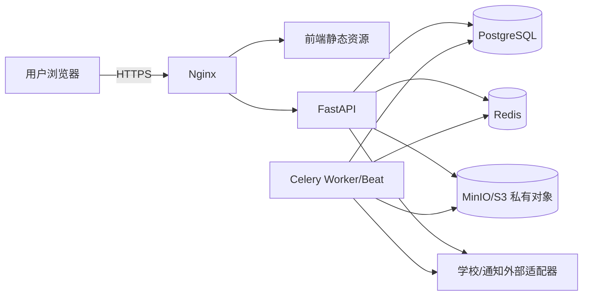

# 部署与运维设计

## 1. P0 部署目标

P0 采用 Docker Compose 管理的模块化单体部署，优先保证可交付、可诊断和可恢复。组件包括 Nginx、前端静态站点、FastAPI 应用、Celery Worker/Beat、PostgreSQL、Redis 和 MinIO/S3 兼容对象存储。生产数据库和对象存储是否使用托管服务由实际环境决定，但安全和备份要求不变。

微服务、Kubernetes、多地域和自动灾备切换不属于 P0。

## 2. 环境划分

| 环境 | 用途 | 数据要求 |
|---|---|---|
| 本地开发 | 单模块开发和测试 | 仅虚构数据 |
| 集成测试 | RLS、对象存储、异步任务、外部契约 | 自动重建的虚构数据 |
| 预发布 | 候选版本验收和恢复演练 | 脱敏或合成数据，配置同构 |
| 生产 | 正式业务 | 严格访问、审计、备份和变更控制 |

环境密钥、对象桶、数据库、Redis 命名空间和外部回调必须隔离，禁止生产密钥下发到开发或前端。

## 3. 网络与访问

只有 Nginx 暴露公网 HTTPS。数据库、Redis、对象存储管理端和 Worker 不直接暴露公网。对象下载通过服务端授权后的短时签名地址，管理控制台限制在运维网络或等价强访问控制内。

## 4. 配置与密钥

- 配置按环境注入并具有启动校验；缺失关键配置时拒绝启动。
- 密码、令牌、签名密钥和对象凭据进入密钥存储或受控环境变量，不写入仓库、镜像和日志。
- 支持密钥轮换；旧密钥的过渡期和回滚需明确。
- 租户业务规则为版本化业务数据，不以部署环境变量硬编码。
- 生产调试开关默认关闭，错误页面和 OpenAPI 管理入口按环境限制。

## 5. 发布流程

1. 构建固定版本镜像并生成组件清单；
2. 执行静态、单元、集成、契约和关键 E2E 测试；
3. 在预发布执行数据库迁移演练和联合恢复验证；
4. 备份生产数据库和对象存储并确认可读取；
5. 以兼容顺序执行迁移、应用和 Worker 发布；
6. 运行健康检查、关键冒烟和权限隔离检查；
7. 观察错误、延迟、队列、资源和关键业务指标；
8. 记录版本、操作者、变更和验证证据。

数据库变更优先采用扩展—迁移—收缩方式，保证新旧应用短时兼容。破坏性迁移必须拆分版本，不能与应用切换一次完成。

## 6. 回滚

- 应用镜像可回滚到前一确认版本；配置版本和 Worker 必须与应用兼容。
- 数据库迁移在实施前明确可逆、前向修复或恢复策略；不得默认依赖自动 downgrade。
- 若新版本已写入新格式数据，优先前向修复或关闭相关入口，不盲目回退应用。
- 发生身份泄露、跨租户访问或文件授权异常时，立即关闭相关入口、撤销签名能力、保存证据并按事件流程处理。

## 7. 备份与恢复

P0 最低要求：

- PostgreSQL 与对象存储每日备份，至少保留最近 7 个可恢复点；
- 记录备份开始/结束、范围、校验、失败和告警；
- 数据库与对象文件使用一致的恢复点或明确的一致性标记；
- 上线前完成一次联合恢复，抽查论文版本、匿名文件、结果、审计和账务关联；
- 恢复凭据与生产凭据分离，备份访问受审计；
- 临时导出默认 7 天清理，清理失败产生告警。

正式 RPO/RTO、异地备份、季度演练和自动灾备切换属于 P1，但不能推翻 P0 的可恢复性底线。

## 8. 可观测性

### 8.1 健康与指标

- 存活检查只反映进程；就绪检查验证必要依赖可用且迁移版本兼容。
- 监控 API 请求量、错误率、延迟、数据库连接/慢查询、Redis、队列积压、任务失败、对象错误和磁盘容量。
- 业务监控包括同步失败、匿名检查阻塞、邀请超时、评阅逾期、通知失败、导出失败和备份失败。

### 8.2 日志与追踪

统一结构化日志和 `request_id`/任务关联标识。日志不得记录论文正文、评语全文、身份映射、访问令牌、对象签名地址和支付敏感字段。生产日志访问按最小权限并记录查询行为。

### 8.3 告警

P0 告警至少覆盖服务不可用、错误率突增、队列持续积压、数据库/对象存储容量、备份失败、同步连续失败、通知持续失败和疑似越权。每项告警必须有责任人、处置说明和升级路径。

## 9. 异步任务运维

任务具有类型、幂等键、重试次数、最后错误和关联业务对象。达到重试上限进入可检查队列，不无限重试。重新执行前先验证任务副作用，防止重复通知、重复费用或重复导出。Beat 仅调度扫描和提醒，不作为业务事实来源。

## 10. 安全运维

- HTTPS、可信代理和安全响应头由 Nginx 与应用共同配置。
- 生产管理入口采用强认证、最小权限和来源限制。
- 定期更新基础镜像和依赖；紧急漏洞具有评估和修补流程。
- 审计数据与普通应用日志分开控制；禁止运维人员通过数据库客户端绕过业务审计进行日常修改。
- 解盲、跨租户维护、账务冲正和恢复均属于高风险操作，需明确审批与完整留痕。

## 11. P0 运维手册清单

- 服务启动、停止和健康检查；
- 发布与回滚；
- 数据库迁移；
- PostgreSQL/对象联合备份与恢复；
- 队列积压、失败任务和通知重试；
- 学校同步故障；
- 存储容量和临时导出清理；
- 跨租户或身份泄露安全事件；
- 密钥轮换；
- 联系人和升级路径。

具体命令和基础设施参数只有在目标环境确认后编写，避免当前文档伪造不可执行的操作步骤。
