下面给你一套**论文送审平台流程体系设计**，用 Mermaid 表达。可以直接放进项目开发文档、README、需求规格说明书或者产品原型说明里。

这些流程建议分成四层：

```text
1. 平台级整体业务流程
2. 角色级业务流程
3. 模块级详细流程
4. 异常/分支流程
```

---

# 1. 平台整体业务流程图

这是最核心的一张图，描述从学生提交论文到结果归档的完整闭环。

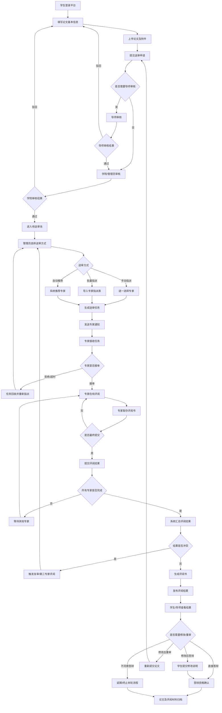

---

# 2. 系统模块架构图

这张图是开发视角，用来说明各模块之间的关系。

```mermaid
flowchart TD
    FE[前端 Vue3 管理端/学生端/专家端] --> API[FastAPI 后端接口层]

    API --> AUTH[认证登录模块]
    API --> USER[用户与权限模块]
    API --> TENANT[学校/学院/专业/批次模块]
    API --> THESIS[论文管理模块]
    API --> WORKFLOW[流程审核模块]
    API --> EXPERT[专家库模块]
    API --> DISPATCH[送审派单模块]
    API --> REVIEW[专家评阅模块]
    API --> RESULT[结果管理模块]
    API --> NOTICE[通知催审模块]
    API --> FINANCE[费用结算模块]
    API --> STAT[统计分析模块]
    API --> FILE[文件存储模块]
    API --> TEMPLATE[模板配置模块]
    API --> AUDIT[审计日志模块]
    API --> INTEGRATION[外部对接模块]

    THESIS --> FILE
    REVIEW --> FILE
    RESULT --> FILE

    WORKFLOW --> AUDIT
    DISPATCH --> NOTICE
    REVIEW --> NOTICE
    RESULT --> NOTICE
    FINANCE --> NOTICE

    DISPATCH --> EXPERT
    REVIEW --> TEMPLATE
    RESULT --> TEMPLATE

    INTEGRATION --> SSO[学校统一认证/SSO]
    INTEGRATION --> GRADSYS[研究生管理系统]
    INTEGRATION --> SMS[短信平台]
    INTEGRATION --> EMAIL[邮件服务]
    INTEGRATION --> CHECK[查重系统]
    INTEGRATION --> JAVA[Java Adapter 可选]

    API --> DB[(MySQL/PostgreSQL)]
    API --> REDIS[(Redis)]
    API --> MINIO[(MinIO 文件存储)]
    API --> MQ[Celery/RabbitMQ/Redis Queue]

    MQ --> TASK1[批量导入任务]
    MQ --> TASK2[批量导出任务]
    MQ --> TASK3[通知发送任务]
    MQ --> TASK4[PDF/匿名化检测任务]
    MQ --> TASK5[催审定时任务]
```

---

# 3. 角色参与流程图

这张图适合放在“用户角色与业务职责”部分。

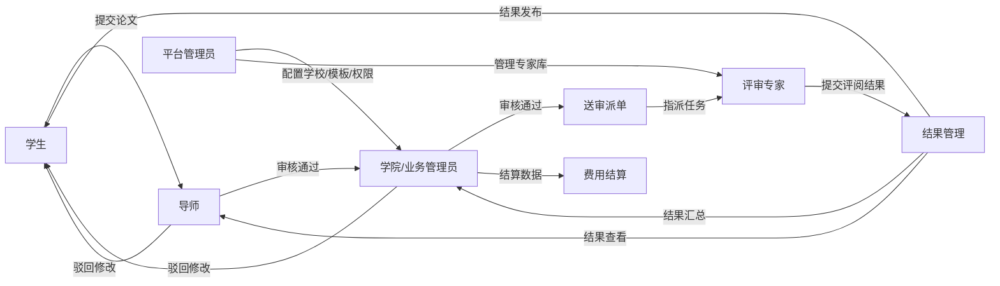

---

# 4. 学生论文提交流程

这是学生端最核心流程。

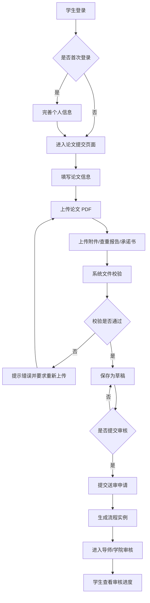

---

# 5. 论文上传与文件校验流程

上传不是简单保存文件，建议独立设计。

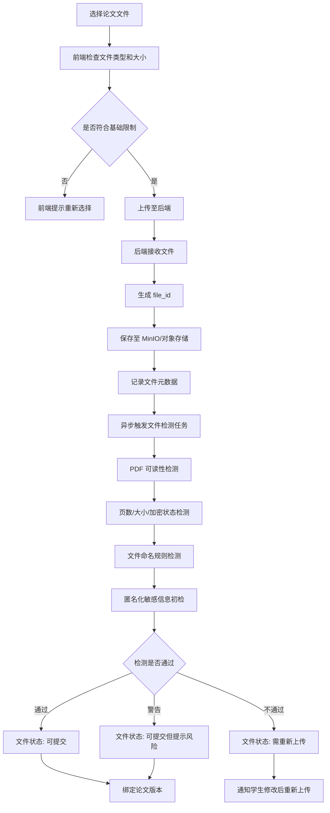

---

# 6. 导师审核流程

导师审核可以配置是否启用。

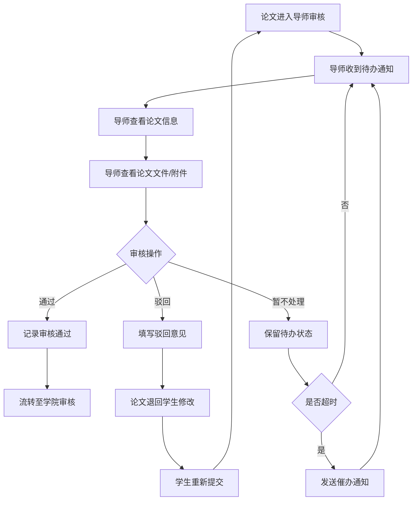

---

# 7. 学院/业务管理员审核流程

管理员审核通常支持批量操作。

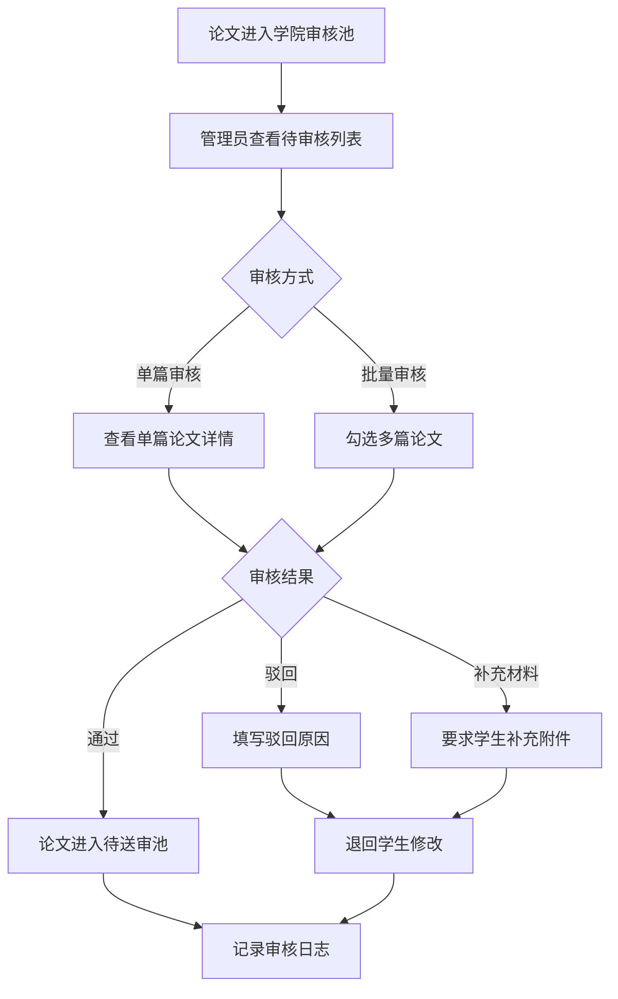

---

# 8. 论文待送审池流程

待送审池是“审核”和“派单”的分界点。

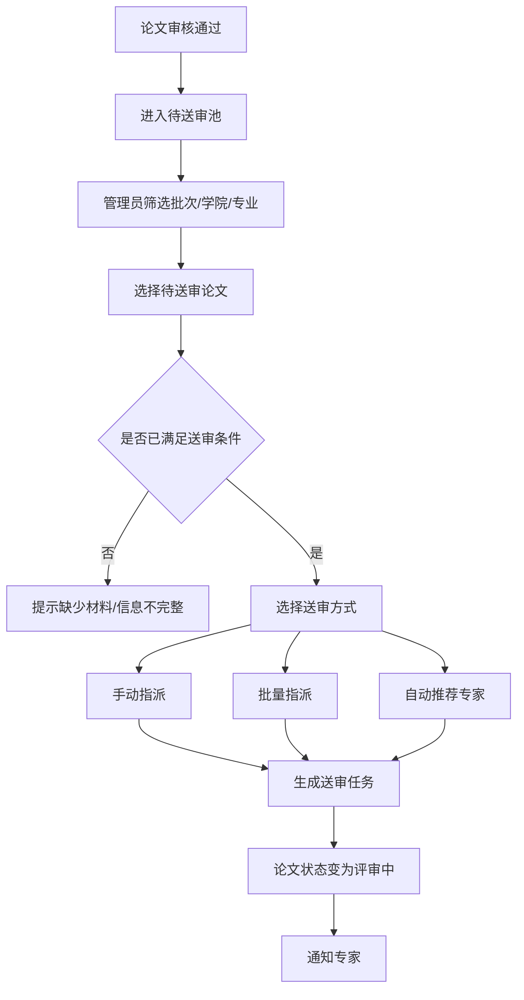

---

# 9. 手动指派专家流程

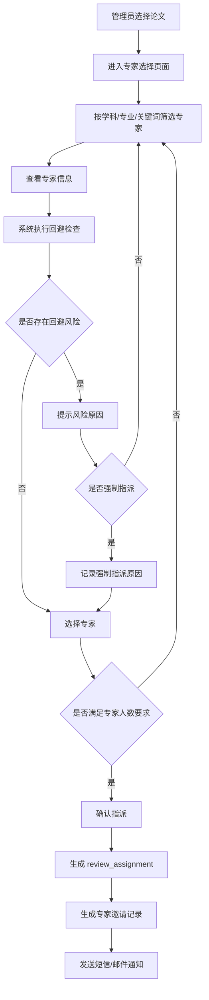

---

# 10. 批量指派专家流程

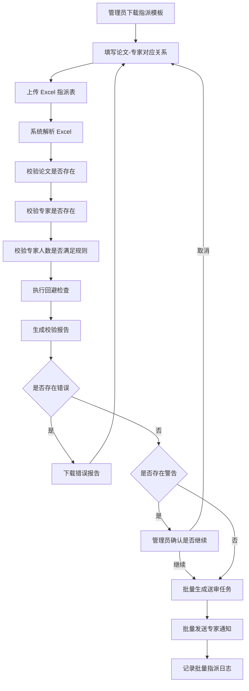

---

# 11. 自动推荐专家流程

第一版可以做半自动推荐，后期再智能化。

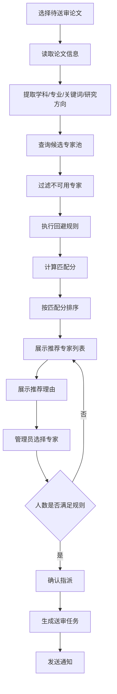

---

# 12. 专家接单流程

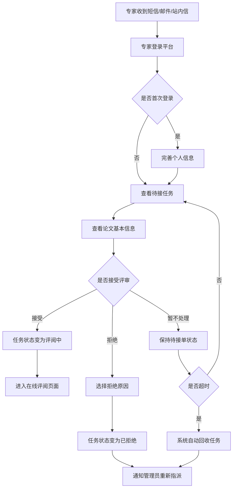

---

# 13. 专家在线评阅流程

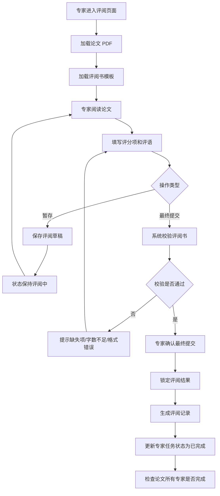

---

# 14. 评阅书模板填写流程

适合描述动态表单。

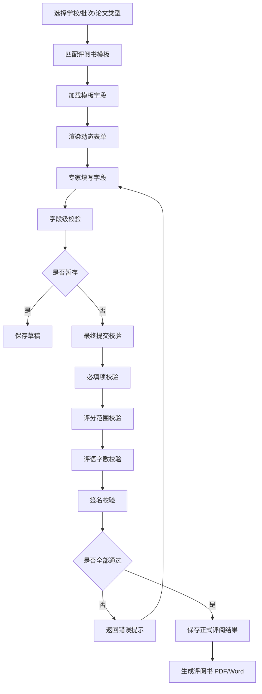

---

# 15. 结果汇总流程

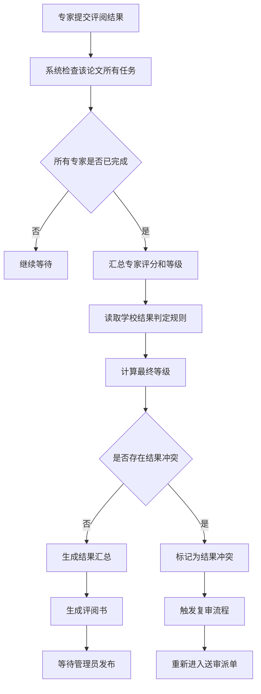

---

# 16. 结果冲突与复审流程

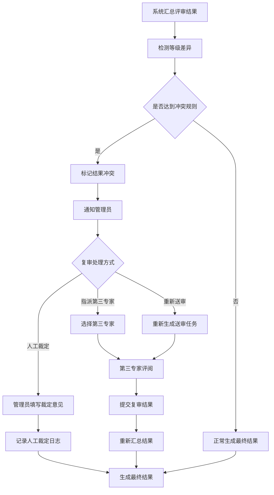

---

# 17. 结果发布流程

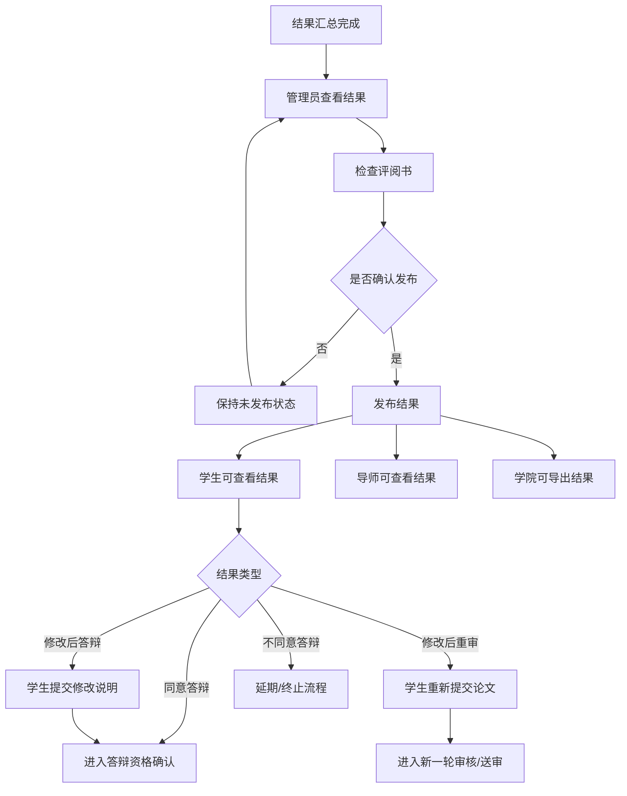

---

# 18. 评阅书生成与导出流程

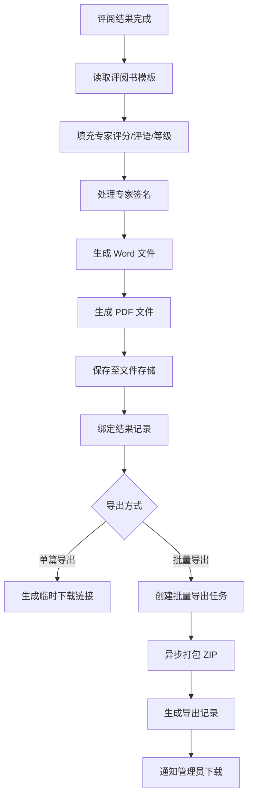

---

# 19. 催审流程

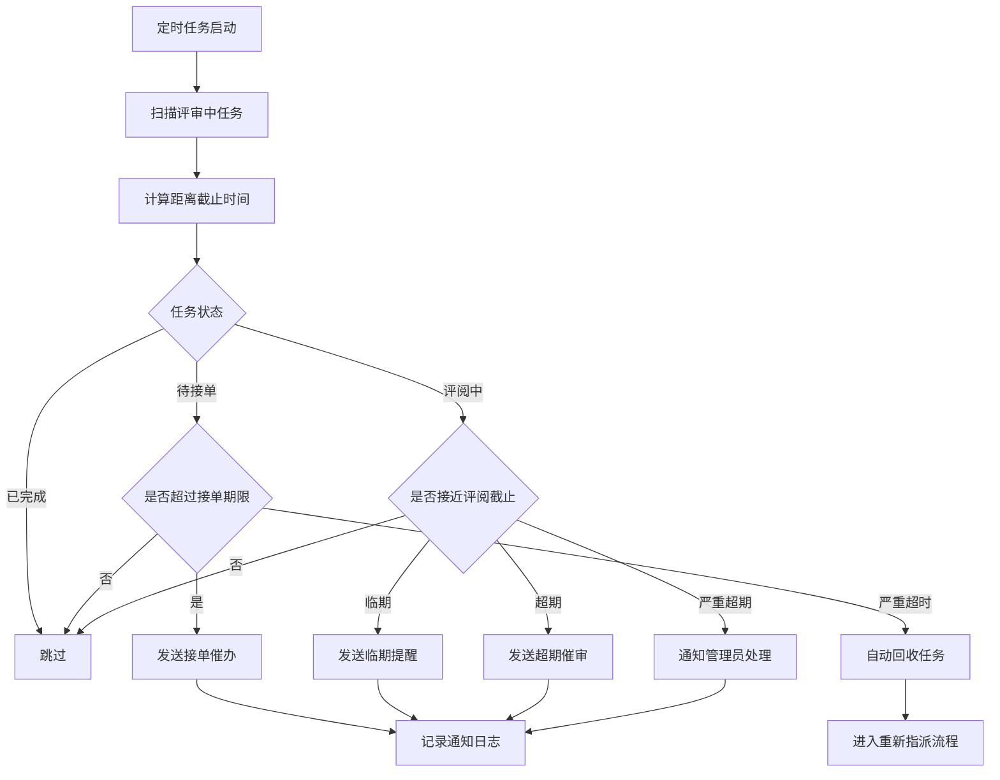

---

# 20. 通知发送流程

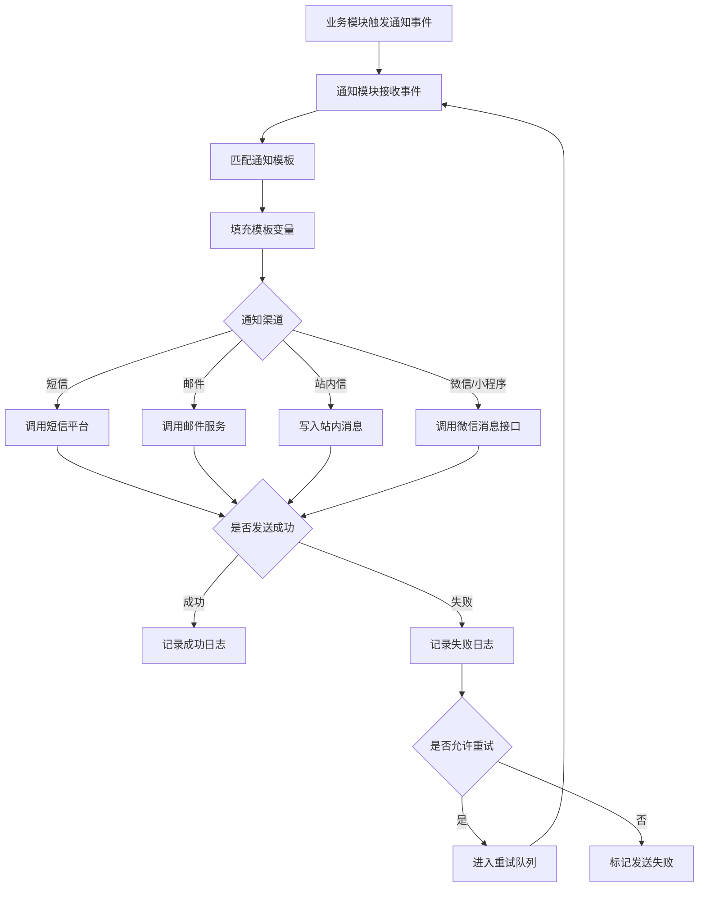

---

# 21. 费用结算流程

第一版建议线下结算，系统做记录与导出。

```mermaid
flowchart TD
    A[专家最终提交评阅结果] --> B[系统读取费用规则]
    B --> C[生成专家评审费记录]
    C --> D[状态: 待结算]

    D --> E[管理员查看结算列表]
    E --> F[按学校/批次/专家筛选]
    F --> G[生成结算批次]
    G --> H[导出结算 Excel]

    H --> I[线下财务付款]
    I --> J[管理员录入付款结果]
    J --> K[上传付款凭证]
    K --> L[状态: 已结算]

    L --> M[专家可查看结算记录]
```

---

# 22. 专家提现流程，后期扩展

如果后期做线上提现，可以这样设计。

```mermaid
flowchart TD
    A[专家查看账户余额] --> B{是否已绑定银行卡}
    B -- 否 --> C[绑定银行卡]
    C --> D[平台审核银行卡信息]
    D --> E{审核是否通过}
    E -- 否 --> C
    E -- 是 --> F[专家发起提现]

    B -- 是 --> F

    F --> G[填写提现金额]
    G --> H[身份/验证码校验]
    H --> I{余额是否充足}
    I -- 否 --> J[提示余额不足]
    I -- 是 --> K[生成提现申请]

    K --> L[财务审核]
    L --> M{审核结果}
    M -- 驳回 --> N[退回余额并通知专家]
    M -- 通过 --> O[调用支付/代付接口]
    O --> P{付款是否成功}
    P -- 成功 --> Q[提现完成]
    P -- 失败 --> R[进入人工处理]
```

---

# 23. 学校统一认证/SSO 登录流程

```mermaid
sequenceDiagram
    participant U as 用户浏览器
    participant FE as 前端
    participant API as FastAPI 后端
    participant SSO as 学校统一认证
    participant DB as 平台数据库

    U->>FE: 点击学校登录
    FE->>API: 请求学校 SSO 登录地址
    API->>SSO: 生成认证跳转 URL
    API-->>FE: 返回跳转 URL
    FE->>SSO: 跳转统一认证
    U->>SSO: 输入学校账号密码
    SSO-->>FE: 回调并携带 code/ticket
    FE->>API: 提交 code/ticket
    API->>SSO: 校验 code/ticket
    SSO-->>API: 返回学号/姓名/身份信息
    API->>DB: 查找或创建平台用户
    API-->>FE: 返回平台 Token
    FE-->>U: 登录成功进入系统
```

---

# 24. Java Adapter 对接老系统流程

```mermaid
sequenceDiagram
    participant API as FastAPI 主系统
    participant JA as Java Adapter
    participant SDK as 学校 Java SDK/JAR
    participant OLD as 学校老系统
    participant DB as 平台数据库

    API->>JA: 请求查询学生身份信息
    JA->>SDK: 调用学校提供的 Java SDK
    SDK->>OLD: 请求老系统接口
    OLD-->>SDK: 返回原始学生数据
    SDK-->>JA: 返回 Java 对象/加密结果
    JA->>JA: 转换为统一数据结构
    JA-->>API: 返回标准 JSON
    API->>DB: 保存或更新学生信息
    API-->>API: 继续平台业务流程
```

---

# 25. 批量导入论文信息流程

```mermaid
flowchart TD
    A[管理员下载 Excel 模板] --> B[填写论文信息]
    B --> C[上传 Excel]
    C --> D[系统解析文件]
    D --> E[字段格式校验]
    E --> F[学号/姓名/专业匹配校验]
    F --> G[论文重复性校验]
    G --> H[生成导入预览]

    H --> I{是否存在错误}
    I -- 是 --> J[下载错误报告]
    J --> B

    I -- 否 --> K[确认导入]
    K --> L[创建异步导入任务]
    L --> M[批量写入论文信息]
    M --> N[记录导入日志]
    N --> O[通知管理员导入完成]
```

---

# 26. 批量导出结果流程

```mermaid
flowchart TD
    A[管理员选择批次/学院/论文] --> B[选择导出类型]
    B --> C{导出类型}

    C -- Excel 汇总表 --> D[生成 Excel]
    C -- PDF 评阅书 --> E[收集评阅书 PDF]
    C -- Word 评阅书 --> F[收集 Word 文件]
    C -- 全部材料 ZIP --> G[收集论文/评阅书/附件]

    D --> H[创建导出任务]
    E --> H
    F --> H
    G --> H

    H --> I[异步生成文件]
    I --> J[保存至文件存储]
    J --> K[生成临时下载链接]
    K --> L[通知管理员下载]
    L --> M[记录导出日志]
```

---

# 27. 权限校验流程

```mermaid
flowchart TD
    A[用户请求接口] --> B[解析 Token]
    B --> C{Token 是否有效}
    C -- 否 --> D[返回 401 未登录]
    C -- 是 --> E[获取用户角色]

    E --> F[校验接口权限]
    F --> G{是否有操作权限}
    G -- 否 --> H[返回 403 无权限]
    G -- 是 --> I[获取数据范围]

    I --> J[根据角色和数据范围过滤数据]
    J --> K{是否能访问目标数据}
    K -- 否 --> L[返回 403 数据无权限]
    K -- 是 --> M[执行业务逻辑]

    M --> N[记录操作日志]
    N --> O[返回结果]
```

---

# 28. 论文状态机图

这是开发实现时非常重要的一张图。

```mermaid
stateDiagram-v2
    [*] --> DRAFT: 创建论文

    DRAFT --> SUBMITTED: 学生提交
    SUBMITTED --> TEACHER_REVIEWING: 需要导师审核
    SUBMITTED --> COLLEGE_REVIEWING: 不需要导师审核

    TEACHER_REVIEWING --> TEACHER_REJECTED: 导师驳回
    TEACHER_REJECTED --> DRAFT: 学生修改
    TEACHER_REVIEWING --> COLLEGE_REVIEWING: 导师通过

    COLLEGE_REVIEWING --> COLLEGE_REJECTED: 学院驳回
    COLLEGE_REJECTED --> DRAFT: 学生修改
    COLLEGE_REVIEWING --> WAIT_DISPATCH: 学院通过

    WAIT_DISPATCH --> REVIEWING: 已派单
    REVIEWING --> REVIEW_COMPLETED: 专家全部完成
    REVIEW_COMPLETED --> NEED_RECHECK: 结果冲突/需要复审
    NEED_RECHECK --> WAIT_DISPATCH: 重新派单

    REVIEW_COMPLETED --> RESULT_PENDING: 等待发布
    RESULT_PENDING --> RESULT_PUBLISHED: 发布结果

    RESULT_PUBLISHED --> REVISION_REQUIRED: 修改后答辩
    RESULT_PUBLISHED --> RECHECK_REQUIRED: 修改后重审
    RESULT_PUBLISHED --> DEFENSE_ALLOWED: 同意答辩
    RESULT_PUBLISHED --> DEFENSE_REJECTED: 不同意答辩

    REVISION_REQUIRED --> DEFENSE_ALLOWED: 导师确认修改
    RECHECK_REQUIRED --> DRAFT: 学生重新提交

    DEFENSE_ALLOWED --> ARCHIVED: 归档
    DEFENSE_REJECTED --> ARCHIVED: 归档

    ARCHIVED --> [*]
```

---

# 29. 专家任务状态机图

```mermaid
stateDiagram-v2
    [*] --> INVITED: 生成邀请

    INVITED --> ACCEPTED: 专家接单
    INVITED --> REJECTED: 专家拒绝
    INVITED --> TIMEOUT: 超时未接单

    TIMEOUT --> RECALLED: 系统回收
    REJECTED --> RECALLED: 管理员回收

    ACCEPTED --> REVIEWING: 开始评阅
    REVIEWING --> DRAFT_SAVED: 暂存草稿
    DRAFT_SAVED --> REVIEWING: 继续编辑

    REVIEWING --> SUBMITTED: 最终提交
    DRAFT_SAVED --> SUBMITTED: 最终提交

    SUBMITTED --> LOCKED: 锁定结果
    LOCKED --> [*]

    RECALLED --> [*]
```

---

# 30. 送审任务生命周期图

```mermaid
stateDiagram-v2
    [*] --> CREATED: 创建送审任务
    CREATED --> NOTIFIED: 已通知专家
    NOTIFIED --> WAITING_ACCEPT: 等待接单

    WAITING_ACCEPT --> ACCEPTED: 专家接受
    WAITING_ACCEPT --> REJECTED: 专家拒绝
    WAITING_ACCEPT --> ACCEPT_TIMEOUT: 接单超时

    REJECTED --> NEED_REASSIGN: 需要重派
    ACCEPT_TIMEOUT --> NEED_REASSIGN: 需要重派
    NEED_REASSIGN --> CREATED: 重新创建任务

    ACCEPTED --> REVIEWING: 评阅中
    REVIEWING --> COMPLETED: 已完成
    REVIEWING --> REVIEW_TIMEOUT: 评阅超时

    REVIEW_TIMEOUT --> REMINDED: 已催审
    REMINDED --> REVIEWING: 继续评阅
    REMINDED --> NEED_REASSIGN: 管理员决定重派

    COMPLETED --> [*]
```

---

# 31. 数据流向图

```mermaid
flowchart LR
    Student[学生] -->|论文信息/文件| Thesis[论文模块]
    Thesis -->|文件元数据| File[文件模块]
    Thesis -->|提交申请| Workflow[流程模块]

    Workflow -->|审核通过| Dispatch[送审模块]
    Dispatch -->|读取专家信息| Expert[专家库]
    Dispatch -->|生成任务| Review[评阅模块]

    Review -->|评阅结果| Result[结果模块]
    Result -->|评阅书文件| File
    Result -->|发布结果| Student
    Result -->|查看结果| Teacher[导师]
    Result -->|统计数据| Statistics[统计模块]

    Dispatch -->|通知专家| Notice[通知模块]
    Workflow -->|待办提醒| Notice
    Review -->|催审提醒| Notice
    Result -->|结果通知| Notice

    AllAudit[所有关键操作] --> Audit[审计日志模块]
```

---

# 32. 模块调用关系图

```mermaid
flowchart TD
    AUTH[认证模块] --> USER[用户权限模块]
    USER --> TENANT[学校组织模块]

    THESIS[论文模块] --> FILE[文件模块]
    THESIS --> WORKFLOW[流程模块]

    WORKFLOW --> NOTICE[通知模块]
    WORKFLOW --> AUDIT[审计模块]

    DISPATCH[送审模块] --> THESIS
    DISPATCH --> EXPERT[专家模块]
    DISPATCH --> NOTICE
    DISPATCH --> AUDIT

    REVIEW[评阅模块] --> DISPATCH
    REVIEW --> TEMPLATE[模板模块]
    REVIEW --> FILE
    REVIEW --> RESULT[结果模块]
    REVIEW --> AUDIT

    RESULT --> TEMPLATE
    RESULT --> FILE
    RESULT --> NOTICE
    RESULT --> FINANCE[费用模块]
    RESULT --> STAT[统计模块]

    INTEGRATION[外部对接模块] --> AUTH
    INTEGRATION --> USER
    INTEGRATION --> NOTICE
```

---

# 33. 推荐文档中的流程图组织顺序

你在开发文档里可以按这个顺序放：

```text
1. 系统整体业务流程图
2. 系统模块架构图
3. 角色参与流程图
4. 学生论文提交流程
5. 论文上传与校验流程
6. 导师审核流程
7. 学院管理员审核流程
8. 待送审池流程
9. 手动指派专家流程
10. 批量指派专家流程
11. 自动推荐专家流程
12. 专家接单流程
13. 专家在线评阅流程
14. 结果汇总流程
15. 复审流程
16. 结果发布流程
17. 评阅书生成与导出流程
18. 催审流程
19. 通知发送流程
20. 费用结算流程
21. SSO 登录流程
22. Java Adapter 对接流程
23. 权限校验流程
24. 论文状态机
25. 专家任务状态机
26. 送审任务生命周期
```

这套 Mermaid 图基本已经覆盖了论文送审平台的所有关键流程。后续做数据库设计、接口设计、前端页面原型时，也可以直接围绕这些流程拆任务。
