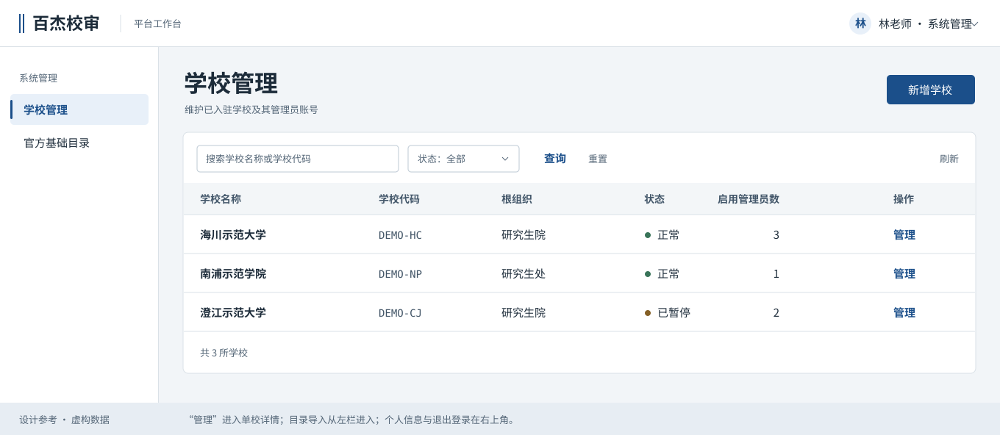

# 百杰校审 · 六角色工作台整体 UI 架构与执行指南

**交付对象：** 下一位设计与前端执行者。**核对基线：** 2026-11-04，`4686bd8`，真实模式 `VITE_DEMO_MODE=false`。本文是改版设计，不代表新界面、文件上传或新权限已经上线。业务规格、服务端权限和已有验收仍然有效。旧的 [UI 设计系统](../../ui-design-system.md) 是历史草案，可沿用品牌基础，不照搬旧页面结构。

> **上一轮方案，保留作现状与契约参考。** 新的页面取舍、视觉方向与执行顺序，以 [十二类页面设计简报](2026-11-04-ui-agent-brief.md) 为准。下方图例与迁移顺序是先前提案，不再作为施工入口。

**定案建议：六角色共用一个可收放的左导航，按任务分配屏幕。** 学校管理、目录与账号归系统管理；分派论文、专家运营与业务审批归平台运营。管理人员在宽屏常用完整侧栏，学生、导师和专家使用更窄的文字侧栏；一旦进入长表单或评阅，默认把导航收起。顶栏始终保留账户入口，登录页不设侧栏。允许重写一整页的布局和模板，不先删除现有前端。

## 1. 先纠正三个会导致改错方向的判断

| 使用时遇到的问题 | 现状依据 | 本次 UI 该做什么 |
|---|---|---|
| 系统管理没有可用导航；学校、目录、管理员一路向下堆 | [菜单](../../../frontend/src/router/menus.ts) 给系统角色配置了默认地址和可访问路径，但没有给它菜单项。[租户页](../../../frontend/src/modules/system/pages/TenantPermissionsPage.vue) 用 PortalLayout，在标题前放目录导入，再列学校，选中后在列表下追加管理员。另有 [AdminLayout](../../../frontend/src/layouts/AdminLayout.vue) 和侧栏，不能据此认定实际页面有左导航 | 系统、运营和学校后台共用管理框架。学校列表与官方目录成为两个可直达的入口；学校管理员随学校详情打开。首次进系统管理就看到学校表 |
| 没有明显的“个人信息、退出登录” | [公共顶栏](../../../frontend/src/components/app/AppHeader.vue) 在真实模式只显示姓名；“切换演示角色”属于 demo。[认证 store](../../../frontend/src/stores/auth.ts) 已有真实退出与清本地会话，[认证 API](../../../frontend/src/api/auth.ts) 已有读取本人信息能力 | 补公共账户菜单和只读个人信息。**这也纠正了此前试用说明：现有真实页不能假定已有可点击的退出入口** |
| 导入似乎只给人看了几个官方文件 | [官方导入组件](../../../frontend/src/components/app/OfficialCatalogImport.vue) 已能预览仓库随附数据的差异，并凭该次预览指纹确认入库；它没有接收用户任意上传的原始文件。[校内专业导入组件](../../../frontend/src/modules/school/components/ProgramCatalogImport.vue) 才有真实 CSV 选文件入口 | 三件事分别命名：**更新官方目录、开通学校、导入本校专业对照**。不要把“已有官方文件”当成用户上传，也不要把更新全国院校名录说成自动开通几千所学校 |

现状视觉样本：[专家任务页](../../reviews/evidence/2026-11-03-expert-task-group-label/in-review.png)、[学校进度与统计](../../reviews/evidence/2026-10-26-e06/school-scope.png)。专家页的时间范围、身份说明、分组、列设置各占一行，一条任务也要到很靠下才出现。改版把范围与列设置放回表格工具栏；在有匿名材料或真实风险时保留明确的隔离提示。不要靠缩小所有字来挤出空间。

## 2. 从哪些后台借鉴，怎样用在这里

| 官方规范／实站案例 | 看到了什么 | 在本平台的决定（设计取舍） |
|---|---|---|
| [Notion · 工作区侧栏](https://www.notion.com/help/navigate-with-the-sidebar) | 在可收起的侧栏中把相关目的地放在一起；阅读时可以关掉导航 | 借用稳定的位置、清晰的间距和内容优先的排版。不照搬无限页面树、工作区切换和协作分享；也不把学校、专家姓名或论文标题塞进全局“最近访问” |
| [shadcn/ui · Sidebar](https://ui.shadcn.com/docs/components/base/sidebar) 与 [Data Table](https://ui.shadcn.com/docs/components/base/data-table) | 侧栏可以独立控制展开方式，表格功能可以按数据集组合 | 顶栏开关不随侧栏一起消失；窄屏用带文字的抽屉；检索、列设置、翻页按真实表能力组合。借用简洁的控件外观，但保留中文标签、学术蓝主动作和键盘焦点 |
| [Screenrove 案例 · Todoist 项目列表](https://screenrove.com/todoist/product/todoist-product-project-list) | 从项目位置进入按任务分组的列表，期限贴着具体任务，视图设置位于列表层 | “我的任务”是目的地，“待接受／评阅中”等是列表视图，截止时间随行呈现；不把六种状态做成六个侧栏页面，也不把盲审任务做成可勾选完成的待办 |
| [Screenrove 案例 · Overleaf 编辑器](https://screenrove.com/overleaf/product/overleaf-product-editor) 与 [Overleaf 官方布局说明](https://docs.overleaf.com/navigating-in-the-editor/working-with-the-pdf-viewer/editor-and-pdf-layout-and-sizing) | 同一对象的阅读与编辑可以并排，空间不足时切成单面板 | 匿名材料与评阅表是同一任务的两个视图，宽屏并排、窄屏切换。没有源码树、共享链接或协作按钮；不能借鉴原产品的分享权限 |
| [Ant Design · 导航](https://ant.design/docs/spec/navigation-cn/) | 浅层浏览与高频、多层管理对导航的要求不同 | 所有角色使用同一侧栏入口；管理角色分组，个人角色仅列真实目的地。分组标签只切同一对象的状态，不用作第二套全站菜单 |
| [Ant Design · 数据列表](https://ant.design/docs/spec/data-list-cn/) | 需要横向比较同类对象时用表格；轻详情和长流程选不同承载方式 | 学校、成员、专家、派单队列用表；一所学校的管理员在详情中管理；在线评阅独占页面。表格只负责“找对象并选择下一步” |
| [IBM Carbon · Data table](https://carbondesignsystem.com/components/data-table/usage/) | 表级操作、行内操作与选中后的批量操作分层 | 刷新和列设置放表右上；“管理”留在该行；暂停、重置密码进入对象详情。没有批量 API 不画复选框和批量按钮 |
| [Ant Design · 字体](https://ant.design/docs/spec/font-cn/)；[W3C · 表格](https://www.w3.org/WAI/tutorials/tables/)及[菜单按钮](https://www.w3.org/WAI/ARIA/apg/patterns/menu-button/) | 易读的字号层次、表头和数据的对应关系、可用键盘访问的账户菜单 | 用中文字体区分办事与阅读；学校表有真正的列标题；右上账户和抽屉不能只靠鼠标悬浮才能操作 |

以上是设计参考，不是采购或换栈建议。实现沿用 Vue 3、现有 Element Plus、现有主题与图标；优先用语义 HTML 或已安装控件，如 [Element Plus 表格](https://element-plus.org/zh-CN/component/table.html)。不另装 Ant、Carbon、shadcn/React 或管理后台模板。

## 3. 权限与账户：同一栋楼，不同钥匙

- **系统管理员**管机构接入、学校管理员、官方基础目录。不因后台外观统一而获得派单、更正审批、论文正文或打分权限。
- **平台运营**管跨校的业务队列、候选专家与回避、负荷、延期及更正审批。只能取得既有业务投影；不用系统管理员接口重置学校账号，也不增加阅读论文或正式评分的权限。
- **现阶段同一个人兼岗**：可以使用两个分别授权的账号。顶栏清楚显示“系统管理”或“平台运营”，从账户菜单退出再登录。现行会话是一个有效角色；不要做前端角色下拉、持有另一组凭据、改本地 role 或合并角色菜单获取数据。
- **以后若确实要一个账号兼岗**：另立后端需求，先设计多角色授予与回收、切换时签发有明确当前角色的会话、缓存隔离、操作者与当次角色的审计，再谈“切换工作区”。另一条路是直接做超级管理员，开发省事，却把账号开通和专家业务操作集中在一个凭据上，本次不选。

**每类用户都能找到自己，也能退出。** 顶栏右上常驻“姓名或用户名 · 当前身份 ▾”；窄屏可以缩短显示，但保留可访问名称。点击或键盘打开后只有“个人信息”和“退出登录”，不放在左侧业务导航，不和“重置他人密码”混在一起。评阅专注页保留精简版账号入口与“返回我的任务”。

- 个人信息先做只读：本人显示名、用户名、当前角色、服务端返回的所属学校代码（平台级账号可写“平台级账号”）。没有可用的人名时回退到本人用户名；没有学校名称就不要猜，不展示内部 UUID、令牌、虚构邮箱或演示姓名。账户信息和“专家业务档案”不是同一屏。
- 正常退出调用现有 `auth.logout()`，清当前页签会话，再用替换历史的方式回登录页；刷新、后退、重新打开受保护的任务 URL 都不应重现上个用户的正文。退出请求失败时仍清本地会话，不宣称服务端已注销全部设备。保留原刷新令牌语义；本次不实现全设备退出。
- 已保存的普通列表直接退出；存在**未保存的编辑**时才询问是否离开，并给“继续编辑”选项。重新登录另一账号要重取数据，列偏好及日期范围遵循原身份隔离，PDF 与草稿不能串人。

## 4. 六角色页面地图

“现有入口”列是基线中可用于真实业务的页面；斜杠地址为前端路由。右侧是**建议的组织方式**，不意味着要建立同名后端模块或暴露全部数据。

| 用户与首要任务 | 现有入口 | 改版导航与页内结构 |
|---|---|---|
| 系统管理员：让一所学校可以开始办理送审 | `/system/tenants` 同时承载目录、学校和该校管理员 | 左栏 **学校管理／官方基础目录**。默认学校表 → 单校详情 → 管理员表；新增学校向导。目录独立入口可新增前端子路由；旧地址仍打开学校表 |
| 平台运营：找待处理论文、找到合规专家、处理异常 | `/platform/dispatch`、`/platform/experts`、`/platform/corrections` | 左栏 **派单工作台／专家库／更正审批**。派单台按队列切换，选论文后再呈现候选、回避原因、负荷和派单动作；延期审批从派单业务上下文进入。专家库用表，档案、资格、回避和导入各有明确入口。不在同一页常驻所有对话框和候选表 |
| 学校审核员：办完本校一批送审 | `/school/preparation`、`/school/progress`、`/school/results`、`/school/objections`；`/school/batch-rules`、`/school/members`、`/school/disciplines`、`/school/sensitive-terms` | 左栏两组：**送审业务**（送审准备、评审进度、结果处理、异议处理）、**本校设置**（批次与规则、成员与资格、学科与专业、材料检测词表）。准备表选论文后核验和确认送出；进度看匿名状态、截止和逾期；结果详情处理发布、更正确认及匿名评阅书。配置页面不夹在办件队列里 |
| 学生：提交合规材料、读到发布结果 | `/student/dashboard` → `/student/thesis/edit`；`/student/results` | 轻侧栏 **我的论文／结果与异议**。选论文后编辑：登记信息 → 原稿与匿名稿 → 检测及送审前清单 → 提交；已保存草稿、被退回、已冻结的主动作分别不同。PDF 工具归所选材料；异议归所选的已发布结果 |
| 专家：处理邀请、阅读匿名论文、提交评语 | `/expert/tasks` → `/expert/invitation`、`/expert/review`（须带既有任务上下文） | 轻侧栏 **我的任务**。六个分组是列表内的视图，不进主导航；保留各组计数与空态，顶部提示随当前分组变化。行上显示该任务允许的接单／继续／查看等操作。评阅页让 PDF 与评分表并排，窄屏用“材料／评阅表”切换并保留草稿。延期、更正挂在相应任务，不新建一排全局入口 |
| 导师：查看自己指导学生的结果 | `/supervisor/results` | 轻侧栏 **学生评审结果**。选择学生论文 → 看已发布匿名意见。只有一个入口时无需额外切页；无已发布结果显示原因，不显示他人的论文或专家身份 |

公共登录为 `/login`，真实模式首推“平台账号”。仅演示或尚不具备真实闭环的费用、提现、通用通知、全局审计查询、通用导出中心、学校 SSO 等不要进正式导航。已有**特定业务的真实下载**（如学校匿名评阅书）仍放回相应业务页。隐藏链接不等于鉴权；真实模式也要测试直接输入旧演示 URL 的结果，不能露出样例身份或假成功。

### 4.1 一套工作台，三种工作方式

**侧栏决定“去哪里”，正文决定“现在办什么”，顶栏负责“我是谁、怎么返回”。** 权限决定哪些目的地可见，当前任务和可用宽度决定布局。学校审核员和导师都可能被叫作“老师”，界面仍按登录身份显示“学校审核”或“导师”；不因称谓相同而混用学生范围。

| 工作方式 | 初次进入的布局 | 代表任务 |
|---|---|---|
| 办理队列 | 宽屏 216px 文字侧栏 + 流式正文，一页一个可处理的业务对象集合；可对照多条记录 | 学校、运营、系统管理；选中一项后打开详情，不滚动跳到页尾 |
| 个人工作台 | 宽屏 184px 轻侧栏 + 正文；学生显示两个目的地，专家、导师各一个，只有一组时省掉分组小标题 | 学生找论文，专家看任务，导师找所指导学生的已发布结果。列表、结果正文按内容决定宽度；不用把每篇论文塞进侧栏，也不为短菜单补“首页” |
| 专注办理 | 从原目的地进入，默认收起全局导航。顶栏保留“菜单”、返回上级、对象标识和本人账户。离开时恢复进入前的侧栏、筛选、焦点与滚动位置 | 学生编辑稿件与材料；专家读匿名稿、写评语。导师通常只读结果，默认保留轻侧栏，可自行收起；评阅邀请是任务详情，无须强制专注 |

**各区域从外到内：**

1. **全局顶栏**：菜单开关、百杰校审、角色工作区、右上本人账户。下钻时给返回或短路径；标题区已经清楚表意时不要再堆三行面包屑。账户在侧栏隐藏时仍能访问。登录是唯一独立的访客布局。
2. **左侧主导航**：当前角色的业务目的地，一层链接，复杂角色最多加一层分组标题。保持稳定顺序和当前页高亮；学生编辑归“我的论文”，邀请和评阅归“我的任务”。单个用户操作过程中不因空数据消失入口。
3. **页面标题与工具栏**：标题说明对象；主按钮是能改变当前业务的主要动作，其他操作降级到行或详情。范围、搜索、分组、列设置留在对应列表。详情打开后可见对象名称、状态、可做之事，不能仅靠面包屑确认操作对象。
4. **工作区与反馈**：长材料在文档画布中呈现；表单错误靠近字段，保存状态贴近操作；整页错误才替代主体。移动抽屉、确认框和账户菜单一次只激活一个，关闭后焦点回触发点。

### 4.2 收展、分栏和阅读尺寸

| 条件 | 主导航 | 内容如何变形 |
|---|---|---|
| 宽度 ≥1200px | 普通页按角色宽度展开，允许收起；专注页默认关闭。开关始终在顶栏同一位置 | 管理表格占可用宽；学生短表单和导师评语正文限制行长；匿名 PDF 与评分表优先使用空间 |
| 768–1199px | 默认收起；打开时作为带中文标签的临时覆盖层，不靠一排无文字图标猜入口 | 先收导航再压表格；详情抽屉用剩余空间。评阅内容区净宽 ≥960px 才双栏，建议材料／表单约 58:42；不足则单面板 |
| <768px | 菜单按钮打开文字抽屉，选中目的地后关闭；当前页、返回和账户仍可见 | 行表可局部滚动，单校详情全屏；评阅用“匿名材料／评阅表”切换。不能让固定操作遮住末项、键盘或错误提示 |

屏宽变化只改变布局，不换任务、不重新提交表单。专注页可临时打开同一角色导航，关闭后仍在原任务；**进入专注不覆盖用户对普通页的收展偏好**。同一任务内切面板不丢未保存输入、阅读位置或有效期内的受控材料；切任务、退出或授权失效时反过来必须丢弃旧对象数据。侧栏是否展开可作身份隔离的显示偏好，不能用于鉴权。涉及访问敏感材料时沿用受控取件与令牌机制。

### 4.3 页面模板与组件边界

| 模板 | 页面结构与优先操作 | 首批覆盖 |
|---|---|---|
| 对象目录 | 标题 + 新建 → 搜索／状态 → 表 → 单对象详情或编辑。首次无数据与筛选无匹配分别引导 | 学校管理、专家库、成员与资格 |
| 办件队列 | 状态视图 + 与视图一致的计数 → 待办行 → 查看或办理；提交后刷新来源队列 | 送审准备、派单、进度、专家任务、异议与更正 |
| 编辑与材料 | 稿件标题／版本 → 登记信息、文件、检测、清单 → 保存或提交。对同一稿件保持连续上下文 | 学生建稿；学校核验中只呈现已获授权的材料和操作 |
| 专注评阅 | 返回任务 + 匿名编号／期限 → 匿名材料与评分表 → 保存状态、检查提示、正式提交；正式版本只读 | 专家在线评阅；小屏切换面板保持输入 |
| 发布与结果阅读 | 明确论文与发布版本 → 结论、评分维度、匿名意见 → 身份允许的后续动作 | 学校核对与发布；学生查看及异议；导师只读。读评语的段落优先，不把长文本挤在表格里 |
| 配置与导入 | 选范围或版本 → 选择／上传许可的数据 → 预览差异 → 确认 → 读回；失败可返回修订 | 全国官方目录、本校学科与校码、批次规则。沿用不同来源的真实契约，不能做一个万能上传按钮 |

**给实现者的分工（概念职责，不要求建立一套同名新组件）：** 路由和现有角色菜单负责“可访问路由、导航父项、普通／专注模式”；共享布局只管顶栏、账户入口和导航收展，不请求论文。队列或阅读模板负责排版与加载、空态、错误位置。业务页继续负责对象 ID、授权动作、版本、可见字段和真实写入；持久化与匿名约束仍在现有 API/store。若第一个样板还没有第二个复用点，优先组合现有布局和控件，不造通用工作流引擎。

### 4.4 跨角色交接才是这套架构的主线

| 上一步完成后 | 下一位去哪里 | 信息如何接力 |
|---|---|---|
| 系统开通学校 | 学校 → 批次与规则／成员与资格／学科与专业 | 学校接管本校配置，不继承全局目录更新权。学生只看本人的资格 |
| 学生提交冻结版本 | 学校 → 送审准备 | 学校核验后确认送出，退回时学生从原论文回到可编辑版本 |
| 学校确认送出 | 平台 → 派单工作台 | 运营看候选、回避与负荷，派单后专家从“我的任务”看到本人邀请 |
| 专家接受和提交 | 专家 → 在线评阅；学校 → 评审进度／结果处理 | 专家仅读获授权匿名材料。提交后该版只读，学校据规则汇总处理；平台不增加读分权限 |
| 学校发布 | 学生 → 结果与异议；导师 → 学生评审结果 | 两端从已发布版本读相应对象。异议回到学校；更正走现有审批和版本确认，不让 UI 直接覆盖正式结果 |

## 5. 第一张样板：系统管理员的学校管理

图中学校全部虚构；“学校代码”示意租户的 `code`，不把它冒充官方院校标识码。图示为桌面构图参考，非运行截图。

1. **默认页：已入驻学校。** 顶部标题“学校管理”，唯一主按钮“新增学校”。默认列：学校名称、学校代码、根组织、状态、启用管理员数、操作。由 [租户返回字段](../../../backend/app/modules/tenant/service.py) 直接取得；人数是**启用**的学校管理员，不是人员总数。建校时间和官方院校代码可进详情；不画没有真实来源的省份分布、合作进度、最后登录、论文量。
2. **找学校：** 学校名称或学校代码关键字 + 状态（全部／正常／已暂停）+ 查询、重置。结果条显示筛选后的数量，空表区分“尚无学校 → 新增学校”和“无匹配 → 清除筛选”。现有接口返回完整授权列表时可以在浏览器内筛选；若改成后端分页，搜索和总数必须一并改到服务端。只在确有多页时出现分页。
3. **管一所学校：** 选行的“管理”在桌面开侧抽屉，窄屏为全屏详情，保留列表滚动和筛选。顶部固定学校名和状态；内容为“机构信息／学校管理员”。管理员也用表：姓名、用户名、人员编号、启用状态、行操作。新增管理员、停用／启用、重置密码依既有接口。暂停整校是**学校级**动作，单列并二次确认，说明对该校后续登录或业务办理的影响；密码不写入日志、截图或列表。关详情回到原行，不在第 80 行下面再展开一张长表。
4. **新增学校：** 先检索已导入的官方目录并单选，核对官方名称与代码 → 根组织 → 首位学校管理员 → 确认建立。沿用原建校命令，不拆成多次写入。查不到时明确提示是搜索无结果还是尚未导入目录，引导有权人员到“官方基础目录”；不靠手输一个同名学校绕过校验。

**三类目录操作的界面与边界**

| 用户要做的事 | 正确入口与步骤 | 明确不发生的事 |
|---|---|---|
| 更新全国院校与研究生学科专业目录 | 系统管理 → 官方基础目录。先分区说明院校／学科、已随系统提供的来源及版本；用“预览本次更新”调现有联合预览接口，逐类列新增／变更／未变，显示官方来源链接 → “确认导入本次预览” → 显示结果；过期或失败需重新预览。来源是[官方数据清单](../../../backend/data/official/manifest.json)，字段与命令见[目录 API](../../../frontend/src/api/catalogs.ts) | 不把“随包版本”写成“库中已发布版本”，不显示捏造的上次导入人和时间。现有确认一次作用于这两类数据；不能把两个页签画成可分别提交。更新名录不创建学校账号 |
| 选择本校可送审的官方学科 | 学校 → 本校设置 → 学科与专业 → 开放学科。按代码／名称搜索、勾选本校范围、保存；学生建稿在允许范围中单选，专家档案按既有契约多选 | 学校不能覆盖全国目录；学生不能编辑字典。学科代码、校内代码都按文本保留前导零 |
| 从学校正式文件导入本校专业代码映射 | 同页“校内专业对照” → 下载[现有 CSV 表头](../../../frontend/public/school-program-template.csv) → 选年度、填校方出处和版本、上传 UTF-8 CSV → 预览变更、修错、确认发布。批次绑定版本另在批次上下文查看；发布新版本不改已绑定批次 | 不是让系统管理员把学校个性化代码写进全国名录。校方 CSV 的模板不要拿来冒充全国目录模板 |

**如果你的“直接导入文本”指全国来源的新文件：** 这是合理的后续需求，不是给现有按钮换一个文件选择器。建议先支持经核验的官方结构化文件：选择数据集／来源版本 → 上传约定模板（或粘贴同模板的制表文本）→ 服务端校验来源、编码、代码、重名与冲突，给逐行错误和差异 → 确认同一指纹 → 原子发布并记审计。任意 PDF、网页或自然语言不直接入库，来源无法验证则不开放确认。待独立后端规格和回归完成后再显示上传入口。

## 6. 其他页面怎么拆，避免回到“大长页”

用三个问题决定摆在哪里：**去另一个业务对象？用导航。仍在同一集合里换状态？用页签。只影响当前一行？用详情或行操作。** 每个页面写得出一个动词和一个宾语，例如“分派论文”。一个功能不应因新做出来就排到页尾。

| 页面类型 | 首屏要回答 | 次要内容放哪 |
|---|---|---|
| 队列（学校准备、运营派单、专家任务） | 现在该处理哪条？当前分组、范围、表头与第一行必须能同时看到 | 派单是“论文队列 → 选定论文 → 候选专家 → 确认派单”。阻断原因和负荷随候选行，详情按需开；不让运营在上下两张长表间来回寻找所选论文 |
| 进度与结果 | 进展到哪、是否能发布？优先给可下钻到列表的状态，逾期未配置不显示伪零 | 学校分数分布可看次级区域，平台看运营状态不取分数；发布或更正确认进单篇详情，显示版本及后果 |
| 配置与档案（成员、批次、专家） | 当前在维护哪个对象？表中选对象，详情维护；路径保留对象与上级 | 校内成员与资格、学科设置与校码映射可以是同一业务下的页签。专家资料编辑、资格、回避放详情，不在列表表头并列八个操作 |
| 编辑与评阅 | 正在改哪一版？材料、可见范围、保存状态、下一步清楚 | 学生分段编辑和校验；专家桌面左右阅读、窄屏切换；长表单可固定保存／提交区。未完成动作不能因换页签丢草稿、PDF 页码或误提交 |

**筛选与表格约定**

- 表前一行优先放关键词和 1–2 个高频条件；低频条件放“更多筛选”，没有额外条件就不画。文字标签常驻，不只用占位符。中文输入法组词中不发请求；Enter 查询，重置后能读懂恢复了什么。“全部／近一年”只出现在原支持页，照旧按论文创建日和北京时间计算，不能变成“最近更新”或套到学校表。
- 每个列表统一选一种交互：多条件组合用“查询／重置”，轻量本地过滤可即时生效。分组与状态筛选不重复；详情返回保留筛选，换登录身份清理临时数据。服务端有截断上限的目录搜索不能把返回行数冒充全国总数。
- 比较字段用真正的列、列标题和行；数字靠右、名称与状态靠左、日期等宽数字。长论文题最多两行，用可聚焦的详情看全称。状态用“文字 + 色彩”，不靠一个红点传达含义。常用行操作露一个明确动词，其余有授权才进“更多”。长表可粘住表头；移动端只让**表区域**横向滚动，名称与主要操作始终能找到。
- 表级工具放右上；学校论文、专家任务、候选专家表已有身份隔离的列显隐、拖动、键盘调序和恢复默认，迁移时保留。不要把列隐藏当成脱敏，不可见字段根本不应返回。沿用原表的交互测试，不为追求一致而让三张已上线的表丢功能。
- 每个数据区至少区分：加载中、从未有数据、查询无匹配、无权或不可见、失败可重试、写入中、成功后的真实读回。写入失败时保留输入；涉及旧版本冲突应提示刷新核对，不能假装成功。对象详情没有权限时不泄露“这个对象其实存在”。

## 7. 国内高校场景的视觉语言

沿用“百杰校审”与现有[主题令牌](../../../frontend/src/styles/theme.css)，让学校人员看到熟悉的登记表、编号、发布版本和日期，让专家有适合长时间阅读的界面。特色来自排版和工作对象，不加校徽、假公章、红头文件、政务标志或大面积水墨装饰。

| 元素 | 可执行规格 |
|---|---|
| 颜色 | 白 `#FFFFFF` 为面，雾灰 `#F2F5F8` 为后台底，深墨作正文，学术蓝 `#1B4F8A` 只强调主动作、链接和选中；淡蓝 `#E8F0F9` 表示所在位置。红只给阻断和危险动作，逾期文字明确，正常状态不铺满整行。沿用一个主题变量来源并映射 Element Plus |
| 中文字体 | 表单、导航、表格使用“苹方／微软雅黑／Noto Sans CJK SC／sans-serif”；品牌、论文题名和正式结果标题少量使用“宋体／Songti SC／STSong／SimSun／serif”。不引远程字体；不要把中文表格改成等宽字。小数、日期使用等宽数字。正文 14–16px、表头 14px、辅助字 12–13px、页标题 24–28px；中文长文行高 1.65–1.8 |
| 布局与密度 | 桌面顶栏约 56–64px，管理侧栏目标 216px、个人侧栏目标 184px，页内 24–32px 留白；表行约 44–48px，双行按内容增高，表头浅灰。办公屏 1366×768 的队列首屏要同时有页名、主动作、筛选、表头和第一条业务数据。不要预留六块空统计卡或大幅品牌横幅 |
| 品牌细节 | 标题突出学校、论文或批次名称。用克制的双线和“仅可见匿名稿／结果已发布”等有事实依据的文字表达双盲。专业代码与名称并列；北京时间标在字段名或日期范围说明。移除用户不需要的 PAGE 编号、英语眉题、接口名和内部状态枚举 |
| 动效与适配 | 统一进入、状态切换、离开动效：控件约 120–160ms、抽屉约 180–220ms；微交互作用于按钮、焦点和选中项，不让整表逐行延迟出现。支持减少动态效果。窄屏侧栏收为有文字名称的菜单，抽屉可全屏，仍可筛选、退出和返回。至少在 390px、1024px、1366px 验证 |
| 可访问性 | 用语义化表、按钮、标签与标题；普通文本对比目标 ≥4.5:1。Tab 可达主动作、账户、行操作与列设置；Enter/Space 打开菜单，Esc 关闭并归还焦点；焦点可见；危险动作与取消不挤在一起。PDF 阅读区切换后能回到表单，不劫持浏览器缩放 |

## 8. 迁移顺序与交付凭据

**重做视觉结构，保留经验证的业务链。** 纯换色解决不了长页；先删页会一并删除路由查询、匿名材料访问、草稿保护、状态门禁和数百个测试的行为依据。采用第三种方式：先定新布局，用一个真实样板验证，再逐页替换展示层。允许删去已经被替代的旧模板和重复样式；每次删除仅限当前页，先查调用者、再对照验收，不能长期维护两套假后台。

| 顺序 | 交给执行者的切片 | 验收后才继续 |
|---|---|---|
| UI-01 公共框架与账户 | 核对工作树、记录六角色原入口与关键页面截图；建立六角色共用的顶栏、可收放侧栏和专注态；接通本人信息和真实退出。复用已有菜单、store、API、焦点及背景锁，不按 route meta 名字盲选布局 | 每个角色能到自己的入口与账户；管理端没有空导航，子页正确高亮父项；登录 A → 退出 → 登录 B 后，后退不会露 A 的数据；粘贴无权深链不会多出任何能力 |
| UI-02 系统管理员样板 | 拆学校管理和官方目录；先交付桌面学校表、单校管理员详情、移动宽度和导入预览四张图，再移植交互。现有 `/system/tenants` 保持兼容 | 筛选、清空、返回原行、校级与人级动作均正确；预览不会写库；确认后查到目录，且入驻学校数不会因此增加。新增学校／管理员须在独立虚构场景验证 |
| UI-03 学校与平台高频队列 | 先迁学校准备／进度，再迁派单和专家库；沿用样板工具栏，由真实业务决定各自列。随后迁批次、成员、字典、词表、更正和异议，不新增示例表或死链接 | 学校匿名可见、运营可派不可越权、专家回避与负荷、日期范围钻取、列设置、期限与延期、错误重试仍能走通 |
| UI-04 个人工作台与评阅 | 学生建稿与材料、专家任务与邀请、专注评阅、学生与导师结果。最后处理登录页和共用状态文案 | 切任务不串稿；专家只能打开被授权的匿名材料；冻结版本只读；学生／导师发布前不可见、发布后可见；六个分组顶部与当前选中一致 |
| UI-05 收口与删旧 | 清点所有真实路由、直达链接和 demo 隔离。移除已无调用的展示代码，保留验收基准；输出每角色的“页面 → 动作 → 结果”及前后截图 | 真实模式浏览器走通学生提交 → 学校核验送出 → 平台派单 → 专家评阅 → 学校发布 → 学生／导师读取及退出。测试、类型检查、真实构建通过；不得把仅有 mock 或 HTTP 成功写成页面验收 |

**执行约束。** 保留当前路由及 `task_id` 等深链、返回路径、已有 store/composables、API 契约、允许动作、幂等、RLS 和既有断言。可使用新前端子路由或子视图，但真实角色可直接打开，刷新有明确去处。不引入前端自制权限、请求中传租户、身份混用或“模拟成功”。如果实现需要更改权限、导入格式、返回字段、令牌或状态语义，单列为后端需求，不在 UI 切片静默实施。

**如何跑与记录。** 使用 [README 的隔离验收命令](../../../README.md#隔离验收环境) 和真实模式。UI agent 单独起一套端口和临时 schema（仅本机 5433/`paper_review_test`），不要停止或复用产品负责人正在手测的会话。基础配置用 `operations`，在评用 `accepted`，已发布用 `published`；从头走流程可用 `empty`。在 frontend 跑对应 Vitest 用例；收口时跑 `node_modules/.bin/vitest run`、`VITE_DEMO_MODE=false npm run build`（含类型检查）。浏览器用独立角色会话，至少交付桌面／390px、非空／空、普通／危险、成功／失败及键盘路径的证据。不得写密码、token 或真实个人材料。不自动提交、推送或部署。

**后续补充按收益排：** 第一批仅用现有能力做好导航、学校表、账号、两类目录入口。下一批如学校数量增大，再单列服务端学校搜索／排序／分页、最近一次官方导入的版本与结果记录；如校方经常提供新文件，再做全国官方文件上传与校验。等真实运营需要再立项多角色工作账号、受控审计检索和账号自助维护。没有真实接口前，不做灰色占位菜单，也不为了让管理员首页热闹而给它论文正文或业务大屏。
